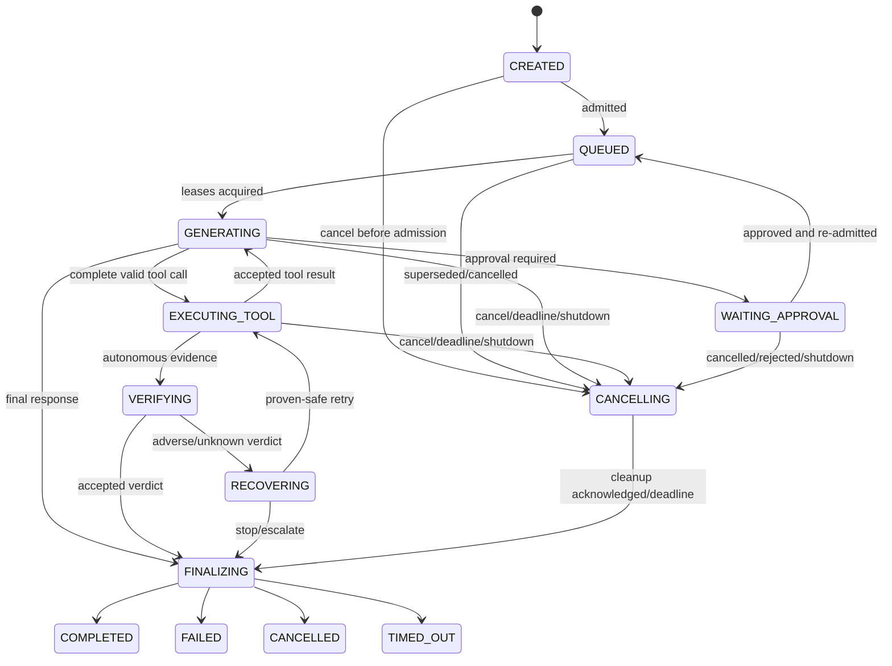

# Task 42.1 — Real-time turn lifecycle architecture

Status: architecture only; proposed contracts below are **not implemented**.
Baseline: `d425ebe0e143d57ab6319583cab7f21ba24e5a29`.

## Scope and invariants

This design adds a real-time coordination layer without changing capability
authority. `ToolExecutor` remains the only execution path:
`ToolRegistry.get` → `Tool.validate_args` → `PermissionPolicy.check` →
`Tool.run` → normalization/logging → `ToolInvocation`. Cancellation and
deadlines are trusted execution context, never model arguments, and may stop a
call but never authorize one.

Conversation session history, autonomous `AgentState`, durable memory, turn
coordination records, and the future action journal remain distinct stores.
Personality and voice presentation sit above these boundaries. Verification
does not execute tools or grant permission; recovery remains bounded and
cannot rewrite failure or unknown evidence as success. Existing filesystem and
permission behavior is frozen.

## Current-state findings

- `agentcore.core.agent.Agent.__init__`/`build_agent` own composition. One
  `PermissionPolicy`, `ToolRegistry`, workspace guard, and `ToolExecutor` are
  constructed; `Agent._build_tool_runner` gives that same executor and policy
  to `ConversationToolRunner`, while `TaskRunner` receives it at line-of-
  authority construction. `Agent.execute`, `run_task`, `_execute_once`,
  `checkpoint`, and `resume` synchronously own autonomous execution and its
  workspace-pinned state.
- `ConversationRuntime.send` appends the user message, retrieves memory,
  synchronously calls `_generate`, captures only the user turn, then saves the
  `ConversationSession`. `_generate` is a bounded sequential
  model → tools → model loop. `ConversationToolRunner.run_calls` intentionally
  executes calls sequentially and routes every valid call to
  `ToolExecutor.invoke`.
- `BaseModelProvider.generate` and `complete`, `LLMPlanner._ask_model`, model-
  assisted verification, and `OpenAICompatibleProvider.generate` are blocking.
  `HttpClient.post_json` owns bounded synchronous retries and sleeps between
  attempts. `urllib` has a per-I/O timeout, but no cancellation propagation or
  streaming contract.
- `TaskRunner.run` executes one ready subtask at a time, records the returned
  invocation through `AgentState.record_tool_call`, then verifies and possibly
  recovers. `Verifier` has no executor and judges recorded evidence.
  `RecoveryPolicy` is deterministic, bounded, does not execute, treats
  `UNVERIFIED` as adverse, and only retries when `assess_retry_safety` proves it
  safe.
- `AgentState.transition_phase` owns autonomous phase legality;
  `JsonFileStateStore` atomically persists it. `ConversationSession` and
  `JsonFileSessionStore` independently persist dialogue. Neither is an
  appropriate owner for a real-time turn state machine. `TaskStatus.CANCELLED`
  is already terminal and non-recoverable, but there is no turn cancellation
  path; `Agent.shutdown` only checkpoints and logs.
- `PermissionPolicy.evaluate` exposes approval-required proposals;
  `PermissionPolicy.check` resolves terminal allow/deny. Conversation prechecks
  approval without running; CLI approve/reject records a decision but never
  executes an action.
- `ToolConfig.default_timeout_seconds` and `tools.max_retries` are validated but
  not consumed by `ToolExecutor`. They are not functioning timeout controls.
  `ModelConfig.timeout_seconds` reaches each HTTP attempt, but retries do not
  share one overall request or turn deadline.
- `SystemClock`/`FixedClock` already provide wall and monotonic time. There is
  no turn coordinator, stream event type, cancellation token, stale-result
  fence, action journal, stable invocation/action ID, or concurrency contract.
  Production creates no worker threads or event loop; the only runtime lock is
  the monotonic timestamp guard.

## A. Turn identity and state

A `Turn` is one admitted user interaction. It belongs to exactly one
conversation session and may *link* to an autonomous run, task, subtask, and
tool/action records; it does not contain or replace them. Autonomous work not
originating from a conversation has no turn. A turn-triggered autonomous run
stores `origin_turn_id`; the turn stores optional `run_id`, never the task
object.

`TurnCoordinator` is the sole creation authority. It uses an injectable ID
factory, defaulting to existing `new_id("turn")`, yielding immutable
`turn_<12 lowercase hex>` IDs. Each admitted turn also receives a per-session
monotonic `generation`; all callbacks and events carry both values. Provider
call IDs, model tool-call IDs, `ToolInvocation`s, and future action IDs remain
separate correlation identifiers.



| From | Legal destinations | Rule |
|---|---|---|
| `CREATED` | `QUEUED`, `CANCELLING` | Persist identity before work. |
| `QUEUED` | `GENERATING`, `CANCELLING` | Only the current session generation starts. |
| `GENERATING` | `EXECUTING_TOOL`, `WAITING_APPROVAL`, `FINALIZING`, `CANCELLING` | Malformed calls fail; they never enter execution. |
| `EXECUTING_TOOL` | `GENERATING`, `VERIFYING`, `FINALIZING`, `CANCELLING` | Only an accepted, non-stale result advances work. |
| `WAITING_APPROVAL` | `QUEUED`, `CANCELLING` | Approval reacquires leases and rechecks policy. |
| `VERIFYING` | `RECOVERING`, `FINALIZING`, `CANCELLING` | Verification consumes evidence only. |
| `RECOVERING` | `EXECUTING_TOOL`, `FINALIZING`, `CANCELLING` | Retry requires existing safety and budget rules. |
| `CANCELLING` | `FINALIZING` | Cancellation is requested, not instantly terminal. |
| `FINALIZING` | one terminal state | Terminal choice is fixed before finalization. |
| terminal | same state only | Identical replay is a no-op; any different target errors. |

`COMPLETED`, `FAILED`, `CANCELLED`, and `TIMED_OUT` are terminal. Deadline
expiry uses `TIMED_OUT`; user/operator/supersession/shutdown uses `CANCELLED`;
internal faults use `FAILED`. A separate action outcome may remain `UNKNOWN`.

Proposed, not implemented:

```python
@dataclass(frozen=True)
class TurnSnapshot:
    turn_id: str
    session_id: str
    generation: int
    phase: TurnPhase
    schema_version: int = 1
    run_id: str | None = None
    requested_terminal: TurnPhase | None = None
    cancellation_reason: CancellationReason | None = None

class TurnController(Protocol):
    def snapshot(self) -> TurnSnapshot: ...
    def transition(self, expected: TurnPhase, target: TurnPhase, *,
                   operation_id: str, note: str = "") -> TurnSnapshot: ...
    def accepts(self, *, generation: int, operation_id: str) -> bool: ...
```

`TurnRecord` schema version 1 is durable: IDs/links, generation, phase and
transition ledger, timestamps, wall-clock deadline, cancellation reason,
terminal outcome, bounded counters, and action references. Raw partial model
text, tool content, tokens, locks, listeners, monotonic clock values, provider
objects, and stream accumulators are ephemeral. Store records atomically in a
new turn store, not session or run state. On restart, a nonterminal turn is
reconciled to cancellation/failure; it is never silently resumed. An action
already started is reconciled separately and may remain `UNKNOWN`.

Only `TurnCoordinator` admits/supersedes; a `TurnController` for that record
performs validated transitions; stage owners report results through the
controller. Callers receive immutable snapshots, not mutable records.

## B. Concurrency and interruption

The supported scope is **one active logical turn per conversation session**.
Different sessions may be admitted independently, but the first implementation
serializes model calls per `Agent` because current providers promise no
reentrancy, and serializes all tool calls per `Agent` through one action lane.
Current autonomous execution also remains one run at a time per `Agent` because
`Agent.state` is singular. Read-only tools do not run concurrently initially:
`read_only` proves effect class, not thread safety or resource independence.
Later concurrency requires an explicit audited `concurrency_safe` contract.

### Process and turn-store ownership

Version 1 supports one owning AgentCore process for a given turn/session store.
Multi-process concurrent ownership is unsupported and must fail safely rather
than permit competing writers. `TurnCoordinator` owns in-process admission
linearization with a short per-session mutex. The durable turn store must expose
optimistic compare-and-swap semantics, conceptually:

```python
def compare_and_swap(
    self,
    turn_id: str,
    expected_version: int,
    next_record: TurnRecord,
) -> TurnRecord: ...
```

`TurnController.transition()` uses the record version plus `operation_id` for
idempotent replay and stale-transition rejection. Disk persistence must be
crash-safe and atomic, but atomic file replacement alone is not multi-process
concurrency control. If a conflict is detected, the losing operation reloads
and rechecks the record and must never overwrite a newer turn record.

The file-backed store flushes record contents before atomic replacement on all
supported platforms. POSIX additionally fsyncs the containing directory for
stronger metadata durability. Windows does not claim a directory-metadata
flush, so sudden power loss may lose the newest replacement despite the
concurrent-write/CAS guarantees remaining intact.

Store I/O and callbacks happen outside coordinator, session, model-lane, and
action-lane locks. Those locks are never waited on while another is held. If an
implementation ever must acquire more than one, order is coordinator → session
→ model → action → store; reverse acquisition is forbidden.

### Successor admission

Coordinator-lock acquisition order is the only version-1 definition of
“newest”; UI timestamps and wall-clock time do not determine ordering. When
another user input arrives for the same session, the active turn is cancelled
with `SUPERSEDED`. There may be only one queued successor. If one is already
queued, it is cancelled with `SUPERSEDED_BEFORE_START` and replaced by the
newly admitted successor. Every accepted input still has its own durable
terminal turn record. No model or tool work begins for a turn after its
generation is no longer current.

The user message is appended once, in generation order, under the session
mutation lease before model work; an interrupted user message stays in the
transcript, while stale/partial assistant output does not. Waiting for approval
holds no model/tool lane. Interruption during verification or recovery stops
further decisions; during tool execution it requests cancellation but cannot
erase possible effects.

Every callback is accepted only when `(session_id, turn_id, generation,
operation_id)` matches the current lease and expected phase. Stale model events
are discarded. Late tool/action results are still journaled as evidence, but
cannot update conversation history, a successor turn, or a terminal outcome.

```mermaid
sequenceDiagram
    participant U as User/UI
    participant C as TurnCoordinator
    participant O as Old stage
    participant N as New turn
    U->>C: submit new input(session)
    C->>O: cancel(SUPERSEDED)
    C->>C: increment generation; queue new turn
    O-->>C: late delta/result(old generation)
    C--xO: reject stale event; journal if action evidence
    O->>C: cleanup acknowledged or cleanup deadline
    C->>N: acquire stage lease
    N->>N: generate using new turn/generation
```

Required race tests cover simultaneous admission, cancel-versus-permission,
cancel-versus-final response, deadline-versus-result, stale deltas, tool return
after supersession, late verifier/recovery, shutdown while approval waits, and
cleanup deadline expiry.

## C. Cancellation contract

Proposed, not implemented:

```python
class CancellationReason(Enum):
    USER_INTERRUPT = "user_interrupt"
    SUPERSEDED = "superseded"
    OPERATOR_CANCEL = "operator_cancel"
    DEADLINE_EXCEEDED = "deadline_exceeded"
    AGENT_SHUTDOWN = "agent_shutdown"
    INTERNAL_FAILURE = "internal_failure"

class CancellationToken(Protocol):
    @property
    def requested(self) -> bool: ...
    @property
    def reason(self) -> CancellationReason | None: ...
    def raise_if_requested(self) -> None: ...
    def register(self, callback: Callable[[CancellationReason], None]
                 ) -> CancellationRegistration: ...

class CancellationSource:
    token: CancellationToken
    def cancel(self, reason: CancellationReason, *, detail: str = "") -> bool: ...
    def child(self) -> CancellationSource: ...
    def close(self) -> None: ...
```

The agent shutdown source is the root; each session admission creates a turn
child; each model/tool/verification/recovery operation gets a child. Session
supersession, user interruption, operator cancel, deadline checker, and internal
failure may cancel the turn source. First request wins atomically; later reasons
are secondary audit facts. `cancel` is idempotent. Registrations invoke once,
outside locks, and `close` removes listeners; terminal finalization closes the
whole tree.

The implementation may use standard-library `threading.Event`/`Lock` for
cross-caller signalling, but it creates no thread. This is required because a
UI or host callback must be able to request cancellation while synchronous work
is blocked; it is not permission to introduce background execution.

Cancellation is cooperative for existing Python/provider/tool boundaries:
check before/after blocking calls, between retry sleeps, before permission
evaluation, after permission and before `Tool.run`, and before every state or
session commit. AgentCore never kills a Python thread. Preemption is permitted
only for a resource it owns and can cleanly terminate later (process handle,
HTTP stream, browser session). An already-issued OS input or external mutation
cannot be undone by cancellation.

Before `Tool.run`, cancellation yields a non-executed categorical result.
During a cooperative read, cancellation yields cancelled evidence. A successful
late result remains truthful invocation evidence but is marked stale and is not
delivered. A mutation cancelled after start records effect `UNKNOWN` unless an
authoritative acknowledgement proves otherwise. Cancellation itself is not a
retryable failure; recovery does not run for cancelled/timed-out turns.

## D. Provider-neutral streaming

The core consumes a synchronous, pull-based iterator—natural backpressure, no
queue, thread, `asyncio`, or third-party dependency. Every proposed event uses
this common correlation envelope:

```python
@dataclass(frozen=True)
class StreamEventEnvelope:
    turn_id: str
    session_id: str
    generation: int
    operation_id: str
    request_id: str
    attempt_id: str
    sequence: int  # Monotonically increasing within one attempt.
```

The event payload variants remain:

```python
StreamStarted(model, provider)
TextDelta(text)
ToolCallDelta(index, call_id=None, name_fragment="", arguments_fragment="")
ToolCallCompleted(index, call: ToolCall)
UsageUpdated(usage: Usage)
ResponseCompleted(response: ModelResponse, completion_metadata: Mapping)
StreamFailed(error_kind, retryable)
StreamCancelled(reason)

class StreamingModelProvider(Protocol):
    def stream(self, request: ModelRequest, *, context: OperationContext
               ) -> Iterator[ModelStreamEvent]: ...
```

Events are ordered per attempt, sequences never repeat, and exactly one
terminal event is accepted. Deltas are provisional. Partial text may be shown
to the current UI but is never saved to `ConversationSession`, captured into
memory, or treated as a final assistant reply. Only `ResponseCompleted` commits
the canonical assistant message and final usage. Bounded counts/status may be
persisted for audit, never raw partial content.

Tool fragments are accumulated in the provider adapter under byte/character
limits. No repair, `eval`, or partial JSON is allowed. Execution is eligible
only after an explicit completed call with nonempty name/ID, arguments decoded
to a JSON object, and the enclosing response completes successfully. It then
enters the existing `ConversationToolRunner`/`ToolExecutor` path. A malformed or
incomplete call fails the model operation and executes nothing.

Transparent model retry is allowed only before any semantic delta becomes
visible. After text or tool-call deltas are published, failure terminates that
attempt; automatic replay could duplicate visible output and is forbidden.
Tool calls are never executed from a failed attempt. A one-shot adapter can
turn existing `generate` into `StreamStarted` + `ResponseCompleted`; the first
streaming provider adds `stream` beside, not inside, conversation core logic.

## E. Deadlines and timeouts

`Deadline` carries an absolute monotonic expiry for decisions and an UTC expiry
for persistence. Child deadlines are `min(parent, requested budget)` and can
never extend an outer deadline. `SystemClock`/`FixedClock` are injected; wall
time is never used for elapsed decisions.

```python
@dataclass(frozen=True)
class OperationContext:
    turn_id: str
    generation: int
    operation_id: str
    cancellation: CancellationToken
    deadline: Deadline

class Deadline(Protocol):
    def remaining(self, clock: Clock) -> float: ...
    def expired(self, clock: Clock) -> bool: ...
    def child(self, max_seconds: float, clock: Clock) -> Deadline: ...
```

- Turn deadline bounds admission through final response.
- Each model request shares one child deadline across all retries; every I/O
  timeout and backoff is clamped to remaining time.
- Tool deadline is the minimum of turn remaining, existing
  `tools.default_timeout_seconds`, and trusted per-tool setting.
- Cleanup receives a separate short grace deadline after cancellation; expiry
  makes the logical turn terminal but does not make an unknown action safe.

User cancellation ends as `CANCELLED`; deadline expiry ends as `TIMED_OUT` and
emits timeout evidence. Ordinary failure ends as `FAILED`. If blocking code
cannot be interrupted, its lease is stale-fenced. Model-only work may drain;
its model lane remains quarantined until physical return unless that provider
has a separately proven concurrent-request contract. The global action lane
remains quarantined while a possibly mutating call is physically live or
unresolved. Future processes use graceful stop then owned process-tree
termination; browser/PC actions close owned sessions and reconcile state. They
never assume that timeout rolled back an action.

Migration first threads deadlines through trusted contexts without enforcing
tool preemption. Then retry sleeps and provider I/O consume remaining budget.
Only tools that implement cooperative checkpoints or owned-resource cleanup may
claim interruptibility. This fixes the unused `ToolConfig` gap without changing
Task 41.3 validation, permission, or filesystem authority.

## F. Side effects and recoverability

Future tools must declare `READ_ONLY`, `IDEMPOTENT_MUTATION`,
`NON_IDEMPOTENT_MUTATION`, or `IRREVERSIBLE_EXTERNAL`; current `read_only` maps
only to the first/unknown split until separately migrated. No mutation tool is
added here.

A separate durable `ActionJournal` serves conversation and autonomous paths.
After validation and permission allow, but before `Tool.run`, `ToolExecutor`
persists an intent with generated action ID, turn/run/task/subtask links,
effect class, redacted argument fingerprint, permission decision, and
`PREPARED` status. `STARTED` is persisted immediately before crossing the
side-effect boundary; `ACKNOWLEDGED` stores an external receipt; terminal
`SUCCEEDED`/`FAILED` follows evidence. Interruption without decisive evidence
records `UNKNOWN`. The action ID is the idempotency key where the external API
supports one.

Read-only work is retryable under existing bounds. Idempotent mutation is
retryable only with the same key and a provider guarantee. Non-idempotent or
irreversible work is retryable only when evidence proves it never started.
After ambiguous timeout/cancellation, a separately admitted read-only
reconciliation action may gather evidence through `ToolExecutor`; `Verifier`
only judges that evidence. Otherwise recovery escalates to an operator.
`UNKNOWN` is never converted to success by model, verifier, recovery, or
restart logic.

Proposed, not implemented:

```python
class ActionBoundary(Protocol):
    def mark_started(self, *, action_id: str) -> ActionRecord: ...
    def acknowledge(
        self, *, action_id: str, receipt: Mapping[str, str]
    ) -> ActionRecord: ...
    def fail(self, *, action_id: str, error: ErrorRecord) -> ActionRecord: ...
    def mark_unknown(self, *, action_id: str, reason: str) -> ActionRecord: ...
```

`ToolExecutor` creates and durably records `PREPARED` only after real argument
validation and permission allow. A future mutation-capable tool receives this
trusted context and must call `mark_started()` immediately before its first
external side effect. It cannot report definitive success without authoritative
acknowledgement or evidence. Cancellation, timeout, crash, or physical return
after `STARTED` without decisive acknowledgement produces `UNKNOWN`. Future
reconciliation remains a separately admitted read-only action through
`ToolExecutor`. `ActionBoundary` is trusted execution context for future
controlled capabilities and is never supplied through model-controlled
arguments.

### Future Gmail and external API integration contract

Gmail is not implemented in Task 42.1 or Task 42.2. Any future Gmail or external
API integration must use OAuth with least-privilege, user-granted scopes; it
must never place passwords or tokens in source, normal configuration, logs,
state, or prompts. Read, draft, send, modify, and delete are separate
capabilities. Recipient resolution occurs before an action, and sending requires
explicit confirmation by default.

External mutations use action IDs/idempotency keys or provider message
identifiers to prevent duplicate sends on retry and retain durable, redacted
intent/result records. Cancellation distinguishes “not submitted” from
“submission outcome unknown.” Incoming email and API text is untrusted data,
never authority or system instructions. Every external action routes through
the same `ToolExecutor`, permission, action-journal, verification, and recovery
boundaries.

## G. Observability, latency, and privacy

Add canonical events: `turn.created`, `turn.queued`, `turn.admitted`,
`turn.model_started`, `turn.first_token`, `turn.tool_started`,
`turn.tool_finished`, `turn.cancellation_requested`,
`turn.cancellation_acknowledged`, `turn.timed_out`,
`turn.stale_result_rejected`, `turn.finalization_started`, and
`turn.finalized`. Bind turn/session/generation and optional run/task/subtask,
operation, call, and action IDs.

Metrics are admission delay, time-to-first-token, model/tool/verification/
recovery latency, total turn latency, cancellation acknowledgement/finalization
latency, stale-event count, and deadline/terminal counts. Reserve
time-to-first-audio but emit nothing until voice exists. Use monotonic durations.
Logs/metrics contain no user/model raw text, raw tool content, arguments,
secrets, sensitive or resolved filesystem paths, external targets, or partial
tool JSON. Reuse structured redaction and log categorical outcomes, lengths,
effect class, and hashes only where needed.

## H. Configuration and staged implementation

The first foundational slice needs **no configuration**: ID format, legal
transitions, cancellation taxonomy, serialization version, and one active turn
per session are invariants, not operator tuning. Existing load precedence stays
defaults < TOML < `AGENTCORE_*` < explicit overrides.

The later deadline-integration slice adds only
`conversation.turn_deadline_seconds=120.0` (valid 1–3600) and
`conversation.cleanup_timeout_seconds=5.0` (valid 0.1–30). A trusted explicit
API deadline may shorten, never lengthen, configuration. Model work is also
clamped by existing `model.timeout_seconds`; tools by existing default/per-tool
timeouts. Streaming buffer caps begin as internal conservative constants and
become configuration only with evidence that operators need tuning.

1. **Foundation.** Add internal `agentcore.realtime.turn`, `cancellation`, and
   `store` with schema-v1 records, deterministic transition controller,
   token/source tree, fixed-clock support, and atomic JSON store. No integration
   or public behavior change. Unit-test every transition, idempotency, callback
   cleanup, serialization, restart reconciliation, and simultaneous cancels.
   Rollback is removal of an unused internal package.
2. **Admission and one-shot conversation integration.** Add `TurnCoordinator`
   at `Agent.conversation` composition, create/admit before `send`, serialize
   session mutation, fence model results, and persist final turn state. Existing
   synchronous provider API remains. Integration-test simultaneous inputs,
   supersession before/during generation, provider ignoring cancellation, and
   session reload. Preserve the existing one-shot provider path as the
   compatibility adapter and rollback boundary.
3. **Deadlines and autonomous correlation.** Add trusted `OperationContext`,
   deadline clamping to model transport/retry sleep, cooperative checkpoints in
   `TaskRunner`, and turn/run correlation without changing `AgentState` phases.
   Test fixed-clock expiry at every boundary, late verifier/recovery rejection,
   shutdown, approval waits, and workspace/permission invariants. Do not claim
   tool preemption yet.
4. **Streaming core and first provider.** Add event schemas, accumulator,
   one-shot adapter, synchronous iterator consumption, then one provider stream
   adapter. Test ordering, backpressure, retry-before-first-delta, malformed
   tool fragments, bounds, cancellation, stale events, and final-only session/
   memory persistence. Existing `generate`/`complete` remain compatible.
5. **Interruptible tools and action journal.** Extend trusted `ToolContext` and
   `ToolExecutor` around—not around the side—of the existing authority path;
   introduce effect classes, intents, acknowledgements, and reconciliation.
   Test every cancel/permission/action race and crash point. Rollout requires a
   separate security review before any mutation/browser/PC capability.

## Adversarial acceptance scenarios

| Scenario | Owner and persisted evidence | Accepted result; recovery/escalation |
|---|---|---|
| Interrupt before model start | Coordinator; queued/cancel transition | `CANCELLED`; no recovery/escalation. |
| Interrupt during output | Model stage; partial counts and cancel reason | `CANCELLED`; partial not persisted; no recovery. |
| Interrupt after parsed call, before executor | Controller; completed call plus no action intent | `CANCELLED`; tool never runs; no recovery. |
| Interrupt during read-only tool | Executor/token; invocation or late-result record | `CANCELLED`; successor may explicitly reissue; no automatic recovery. |
| Mutation interrupted after possible effect | Executor/action journal; `STARTED`, receipt if any | Turn cancelled/timed out, action `UNKNOWN`; no retry; operator required. |
| Model event after supersession | Coordinator generation fence; stale-event event | Old turn remains terminal; discard; no recovery/escalation. |
| Tool returns after timeout/cancel | Executor/action journal; truthful late invocation | No turn advancement; read-only recorded, mutation may be `UNKNOWN`; escalate latter. |
| Late verifier/recovery callback | Controller operation fence; stale callback event | Terminal state unchanged; no recovery/escalation. |
| Two simultaneous inputs | Coordinator admission lock; both turn records/generations | Lock winner starts then is superseded by latest; earlier cancelled; no escalation. |
| Shutdown while approval waits | Root source; pending approval and shutdown reason | `CANCELLED`; approval revoked/retained only as audit; no execution or recovery. |
| Restart with ambiguous action | Restart reconciler/action journal | Turn terminal, action `UNKNOWN`; no automatic resume/retry; operator required. |
| Provider temporarily ignores cancel | Model lease/fence; requested/ack latency | Turn cancels after cleanup grace; late events discarded; no recovery. |
| Malformed/incomplete streamed args | Provider accumulator; categorical parse error, lengths only | `FAILED`; executor not entered; retry only if no semantic delta was exposed. |
| Deadline expires during cleanup | Controller/deadline; cleanup-expired event | `TIMED_OUT`; stale fence remains; unknown action quarantines lane and escalates. |
| Cancellation races permission denial | Executor checkpoints; decision plus cancellation order | Tool never runs. Cancellation wins before final commit; denial remains evidence; no recovery. |

## Non-goals and Task 42.1 acceptance

No runtime streaming, provider change, voice, browser/PC control, shell/process,
network tool, scheduler, database, capability, concurrency worker, timeout
enforcement, or cancellation behavior is implemented by Task 42.1. It does not
alter `AgentState`, `ToolExecutor`, permissions, filesystem rules, verification,
recovery, or persistence behavior.

Task 42.1 is accepted when this document identifies current owners, fixes every
state/concurrency/cancellation/stream/deadline/effect/observability/configuration
decision, defines stale and unknown semantics, covers the adversarial cases,
and supplies independently testable implementation stages. **No runtime code
was implemented.**

## Task 42.3 integration amendment — 2026-08-21

Status: **approved project-lead decisions; architecture only, no runtime code
implemented by this amendment.**

Baseline: this document plus accepted Task 42.2 implementation
`797e2f5c8087423d72a2e972adaa350b47b4393f`. Task 42.2 is complete.

This amendment settles the integration questions raised against stage 2
(*Admission and one-shot conversation integration*) in section H. It refines
the wording of sections B, E, G and H where noted; it does not introduce a new
architecture, a new capability, a new configuration key, or a new durable
schema version. `TURN_SCHEMA_VERSION` remains `1`. Every invariant in *Scope
and invariants* stands unchanged: `ToolExecutor` remains the only execution
authority, permissions and filesystem behavior are frozen, and personality and
presentation remain above runtime authority.

### 1. Per-Agent stage lease (settles C-1)

Stage 2 adds one **per-`Agent` reentrant stage lease**. It is the concrete
implementation of the "stage lease" referenced in section B's successor
admission sequence, and it is the only mechanism permitted to serialize model
and tool work within one `Agent`.

Ownership and ordering rules:

- Admission never waits for the stage lease and never holds it.
  `TurnCoordinator.admit` continues to acquire only its short per-session
  admission lane.
- A newly admitted successor may therefore cancel the active turn and queue
  itself **while its predecessor is physically running**. Supersession
  ordering remains coordinator-lock acquisition order, never wall time.
- The stage owner acquires the stage lease **before** transitioning
  `QUEUED → GENERATING`.
- The owner holds the lease across: the synchronous provider call; any
  conversation tool round; the stale-fence decision; every session mutation
  owned by that turn; and the turn's final durable transition.
- The owner **terminalizes its durable turn record before releasing the
  lease**.
- A successor cannot begin model or tool work until the predecessor has
  terminalized and released the lease. This preserves the coordinator's
  requirement that at most one non-terminal turn per session is past `QUEUED`.

Lock-discipline rules, which refine the section B sentence "Store I/O and
callbacks happen outside coordinator, session, model-lane, and action-lane
locks":

- No coordinator mutex is held while waiting for or acquiring the stage lease.
- No session lock is held while waiting for the stage lease.
- Session locking is narrow. It may be taken **inside** the stage lease, and
  only for append and save operations.
- No `TurnStore` internal lock is held while calling provider or tool code.
- The minimal trusted `TurnStore` and session persistence required to
  terminalize a turn and hand off to a successor **may** occur while the stage
  lease is held.

The final bullet is the intended refinement. The older blanket wording is
superseded for stage 2 only, and only for this minimal terminalize-and-hand-off
persistence; it remains in force for coordinator, session and action lanes and
for all other store I/O.

Cancellation remains **cooperative only** in Task 42.3, consistent with
section C. A provider or tool that ignores cancellation keeps the successor
waiting until physical return, exactly as section E's "quarantined until
physical return" already states. Task 42.3 therefore delivers correct turn
accounting, supersession and stale fencing, and **must not claim barge-in
latency, forced interruption, or preemption**. No worker thread is introduced.

### 2. Opaque turn-session correlation key (settles C-2)

Existing `ConversationSession` and CLI session-ID validation is **not**
tightened. Session identity remains whatever current session behavior accepts.

`TurnRecord.session_id` stores a **derived correlation key**, never the raw
`ConversationSession` identifier:

- Derive from the exact UTF-8 bytes of the raw session ID using a
  domain-separated SHA-256 digest, rendered as lowercase hexadecimal and
  prefixed with `session_`.
- The domain separator is a fixed constant reserved for this purpose, so the
  digest cannot collide with any other AgentCore key derivation.
- The result satisfies the existing safe `TurnRecord` link-ID charset and
  length rules without transformation, truncation, or escaping.
- Derivation is deterministic, collision-resistant, and one-way: the raw
  session ID is not recoverable from the record.
- Session IDs containing spaces, Unicode, `#`, `.`, `..`, or any length the
  current session layer accepts remain compatible, because none of those bytes
  reach the turn record.
- The caller still rejects an empty raw session ID before derivation; an empty
  input is a caller error, not a valid correlation key.

Observability follows the same rule. Turn events, turn metrics and any
turn-result correlation field expose the safe derived key only. The raw session
ID is never written into a `TurnRecord`, a turn event, or a turn metric. This
refines section G's binding requirement accordingly.

### 3. Durable turn-store ownership is opt-in (settles C-3)

Task 42.3 is **opt-in**:

- Existing `Agent` and CLI behavior is unchanged when no realtime coordinator
  or turn store is explicitly injected. With nothing injected, conversation
  behaves exactly as it does today; this is the stage-2 rollback boundary
  required by section H.
- Task 42.3 does **not** automatically create a `JsonFileTurnStore`.
- Task 42.3 adds **no** configuration for turn-store placement, and section H's
  "first foundational slice needs no configuration" continues to apply.
- An explicit host-injected durable `JsonFileTurnStore` is responsible for
  single-process ownership, exactly as *Process and turn-store ownership*
  already specifies.
- If explicit durable ownership fails, the failure is **categorical**. It never
  silently downgrades to `InMemoryTurnStore`, and it never continues without
  the durability the host asked for.

This preserves today's multiple-CLI-process behavior until a later deployment
and configuration task defines durable-store placement and ownership policy.
That later task owns the decision; Task 42.3 does not pre-empt it.

### 4. Counters and session lookup cost (settles C-4)

- Task 42.3 does **not** mutate frozen `TurnRecord` counters. The accepted
  Task 42.2 CAS contract holds all non-transition fields, including
  `TurnCounters`, invariant for a record's life. Section A's counter list
  therefore describes reserved schema-v1 capacity, not a stage-2 write path.
- Stale-result, model-request and tool-call counts are reported through the
  privacy-safe observability events in section G. Those events carry
  categorical outcomes, counts and safe identifiers only, never raw text,
  arguments, tool content, or resolved paths.
- The coordinator's per-admission session lookup is O(all turns) in the store
  domain. This is recorded as a **known performance limitation** of stage 2.
  It is explicitly **not** a reason to redesign the turn store, add an index,
  or change CAS semantics during Task 42.3. A later task owns any bounded or
  indexed lookup.

### 5. `Deadline.unbounded()` scaffolding (settles C-5)

Stage 2 must not fabricate a far-future deadline to satisfy
`OperationContext`. Instead a named, non-enforcing semantic is defined:

- `Deadline.unbounded()` carries **no** monotonic expiry and **no** UTC expiry.
- `expired()` is always false for an unbounded deadline.
- No deadline is persisted on the turn record; `deadline_at` stays absent.
- A child deadline may later shorten an unbounded parent during the
  deadline-integration stage, consistent with section E's rule that a child is
  `min(parent, requested budget)` and can never extend an outer deadline.
- It is explicit scaffolding for the `OperationContext` the stale fence
  requires. It is **not** timeout enforcement, and it must never be described
  as one.

Turn, model-request, tool and cleanup budgets remain unimplemented in Task
42.3. Section E's migration ordering is unchanged: deadlines are threaded
through trusted contexts in the later stage, and tool preemption is still not
claimed.

### 6. Approval and provider-failure categories (settles C-6 and C-7)

- Existing approval behavior remains **non-blocking** in Task 42.3. A tool call
  that requires human approval is still pre-checked without executing, still
  escalates through the existing `PendingAction` path, and the turn may still
  complete normally with a truthful non-executed outcome.
- `WAITING_APPROVAL` and its `→ QUEUED` re-admission edge are **not used** in
  Task 42.3. They remain reserved in the section A state machine for the later
  stage that makes approval blocking. Leaving them unused is a deliberate,
  recorded deviation from the section A diagram, not a redesign of it.
- Ordinary provider generation failure terminalizes as `FAILED` with the
  existing `INTERNAL_FAILURE` cancellation category. No schema enum value is
  added in Task 42.3, because the cancellation vocabulary is durable
  schema-v1 state.
- This is **known categorical imprecision**: an external provider fault is
  recorded under an internal-failure category. It is accepted for Task 42.3 and
  assigned to whichever later stage revises the durable cancellation
  vocabulary under schema review.

### 7. Supersession vocabulary unchanged (settles C-9)

Task 42.3 does **not** change the existing `SUPERSEDED` /
`SUPERSEDED_BEFORE_START` vocabulary or the conditions under which the
coordinator selects between them. Both already terminalize as `CANCELLED` with
a durable, truthful record, so the distinction is audit vocabulary only.
Accepted Task 42.2 behavior stands.

### Task 42.3 acceptance checklist

Task 42.3 is accepted when all of the following hold:

1. A turn is created and admitted before any conversational model work, and
   every accepted input has its own durable terminal turn record.
2. At most one active logical turn per session, with at most one queued
   successor, is observable in the durable store at all times.
3. Session mutation and model calls are serialized per `Agent` by the stage
   lease and narrow session locking described above, with the stated
   acquisition and non-holding rules respected.
4. A successor admitted during a live turn supersedes it safely and begins
   model or tool work only after the predecessor has terminalized and released
   the stage lease.
5. A stale model result or a late tool result cannot mutate conversation
   history, a successor turn, or a terminal outcome; the interrupted user
   message still remains in the transcript.
6. Final turn state is durably persisted for success, failure, and
   cancellation, with no stranded non-terminal turn after error, shutdown, or
   restart reconciliation.
7. The existing synchronous one-shot provider path is unchanged and remains the
   compatibility adapter and rollback boundary.
8. `ToolExecutor` remains the single execution path, and all permission and
   approval behavior is byte-for-byte preserved.
9. `AgentState`, conversation session state, durable memory, and `TurnRecord`
   remain four separate stores linked only by opaque identifiers.
10. With no coordinator or turn store injected, behavior is identical to the
    pre-Task-42.3 baseline.
11. Turn records, turn events and turn metrics contain no raw session ID, user
    or model text, tool arguments or output, secrets, or resolved filesystem
    paths.

### Task 42.3 non-goals

Task 42.3 implements no streaming, no provider change, no voice, no turn
detection or barge-in, no browser or computer control, no shell, process or
network capability, no scheduler or background worker, no action journal or
effect classes, no mutation tooling, no deadline or timeout enforcement, no
tool preemption, no forced interruption, no blocking approval, no new
capability, no new configuration key, no dependency change, and no durable
schema change. It does not alter `AgentState` phases, `ToolExecutor`,
permissions, filesystem rules, verification, recovery, or existing persistence
behavior.

## Task 42.5 streaming implementation amendment — 2026-08-24

Status: **project-lead implementation contract; architecture only.** This
amendment implements no stream event, transport, provider, conversation, test,
configuration, or workflow code.

Baseline: the merged runtime at
`c151643346d2275d24ee60e1ef4d9892d19390a8` (Task 42.4d). Tasks 42.2, 42.3,
42.4a, 42.4b, 42.4c, and 42.4d are complete and are not reopened here. Older
passages in this document that say a turn coordinator, cancellation,
deadlines, stale fencing, or related mechanisms are "proposed, not
implemented" remain historical context. They do not describe the baseline for
Stage 4. The merged code and tests at the baseline commit are authoritative
where those historical passages describe an earlier repository state.

No frozen rule below contradicts that baseline. The baseline has no streaming
API or stream event types yet; that absence is the work assigned to Stage 4,
not a contradiction. In particular, the merged implementation already
provides the authority and finalization boundaries that streaming must retain:

```text
ConversationRuntime.send
  -> TurnBridge.run
  -> per-Agent StageLease
  -> _TurnFence.activate
  -> ConversationRuntime._run_turn
  -> _generate
  -> _call_model
  -> provider.generate / complete
  -> HttpClient
  -> ModelResponse
  -> optional ConversationToolRunner
  -> ToolExecutor
  -> fence.commit
  -> staged tool-message publication
  -> final assistant session append
  -> memory capture from the USER turn only
  -> session save
  -> turn terminalization
```

The current `_TurnFence` carries the admitted turn's trusted
`OperationContext` and exact clock domain, checks durable currentness, stages
owned tool messages, and fixes successful outcome at `fence.commit()` before
publishing generated transcript. `TurnRecord.session_id` is already the
opaque, domain-separated derived session key. `CancellationToken` already
supports synchronous callback registration. The current OpenAI-compatible
provider and `HttpClient.post_json` are one-shot APIs with bounded retries and
deadline clamping. `TURN_SCHEMA_VERSION` is `1`. Stage 4 extends these facts;
it does not replace them.

### Purpose and frozen implementation slices

Stage 4 makes model generation incrementally observable without weakening turn
authority, stale-result fencing, deadline truth, cancellation truth, tool
authority, transcript durability, memory boundaries, privacy, or retry truth.
Every partial result is **provisional**. Presentation is never persistence, and
presentation is never permission.

Stage 4 is split into three separately reviewed changes:

1. **42.5a — provider-neutral stream foundation.** Add immutable neutral event
   schemas, the trusted envelope and validation, the accumulator/state machine,
   the one-shot `generate`/`complete` compatibility adapter, and attempt/retry
   invariants. It adds no network streaming and changes no
   `ConversationRuntime` behavior.
2. **42.5b — conversation stream integration.** Add synchronous iterator
   consumption, per-event stale fencing, an opt-in presentation sink,
   first-token observability, provisional delivery, final-only persistence,
   and streamed-tool-call execution fencing. Tests use fake streaming
   providers and deterministic synchronization. It adds no real SSE provider.
3. **42.5c — OpenAI-compatible real streaming.** Add a narrow owned HTTP stream
   seam, bounded SSE and tool-fragment parsing, retry-before-semantic-output,
   cancellation of the owned stream, deadline propagation, and canonical final
   `ModelResponse` normalization. Existing one-shot APIs remain supported and
   behavior-compatible.

Stage 4 is complete only after 42.5a, 42.5b, and 42.5c have each been audited,
tested, CI-green, and merged. This amendment does not implement any of them.

### Synchronous pull model and opt-in conversation API

The core consumes `Iterator[ModelStreamEvent]` synchronously. There is no
`asyncio`, producer or worker thread, background prefetch, queue, websocket
framework, or third-party streaming dependency. Pull-based iteration is the
backpressure mechanism: event N+1 is not requested until event N has been
parsed, validated, fenced, and, when enabled, synchronously delivered.

The public conversation direction is explicitly opt-in:

```python
ConversationRuntime.send(
    ...,
    on_stream_event=None,
) -> TurnResult
```

The exact identifier may follow established project naming style, but these
semantics may not change:

- `on_stream_event is None` uses the existing one-shot conversation path. A
  provider's streaming capability never silently selects streaming.
- Supplying a sink requests streaming and requires a currently owned realtime
  turn admitted through `TurnBridge`. This applies even when the selected
  provider ultimately uses the one-shot compatibility adapter.
- If no realtime turn exists, fail before model execution and before any
  streaming-specific session mutation. Never mint a fake `turn_id`,
  `session_id`, `generation`, or `operation_id` to make an unowned call look
  owned.
- Opt-in streaming does not alter the return type or authority of `TurnResult`.
  Only successful canonical completion can create its reply.

### Trusted event envelope and immutable neutral events

Every stream event exposed outside the provider adapter carries an immutable
`StreamEventEnvelope` with exactly these trusted correlation fields:

```python
@dataclass(frozen=True)
class StreamEventEnvelope:
    turn_id: str
    session_id: str
    generation: int
    operation_id: str
    request_id: str
    attempt_id: str
    sequence: int
```

- `turn_id` is the current admitted turn ID.
- `session_id` is the existing derived opaque correlation key, never the raw
  `ConversationSession.id`.
- `generation` is the admitted turn generation.
- `operation_id` is the current `GENERATING` operation identity held by the
  fence for this model round.
- `request_id` is a new opaque ID for one logical model request, meaning one
  model round in the bounded conversation loop.
- For native streaming, `attempt_id` is a new opaque ID for exactly one
  observable physical streaming transport attempt. For one-shot compatibility,
  it identifies one compatibility-adapter attempt around exactly one selected
  legacy provider invocation.
- `sequence` is zero-based and exactly contiguous within an attempt.

A native retry retains `request_id`, creates a new `attempt_id`, and resets
`sequence` to zero. One-shot compatibility has one `request_id`, one adapter
`attempt_id`, and one selected legacy provider invocation. Retries performed
inside that legacy invocation are intentionally opaque: the adapter neither
fabricates attempt IDs nor emits `StreamStarted` / `StreamFailed` events for
internal retries it cannot observe. This is the sole compatibility exception
to the phrase "physical attempt" and does not weaken native-stream attempt
truth. A later model/tool/model round creates a new `request_id` under the
then-current `GENERATING` operation. All envelope values come from trusted
runtime identity factories and context. They are never model- or
provider-generated. An envelope contains no raw session identifier, secret,
header, tool argument, user/model text, or other payload content.

42.5a freezes immutable/frozen neutral variants:

- `StreamStarted`: safe provider/model metadata only;
- `TextDelta`: provisional text;
- `ToolCallDelta`: bounded nonnegative `index`, optional call-ID fragment or
  value, function-name fragment, and argument-string fragment;
- `ToolCallCompleted`: a validated neutral `ToolCall`;
- `UsageUpdated`: neutral `Usage`;
- `ResponseCompleted`: the stream-safe canonical `ModelResponse`, always with
  `raw={}`;
- `StreamFailed`: categorical, sanitized failure information including
  `retryable: bool` and `will_retry: bool`;
- `StreamCancelled`: the winning trusted `CancellationReason`.

No neutral event carries provider dictionaries, raw headers, raw HTTP
exception text, raw SSE frames, or unsanitized provider error text.

### Attempt state machine, semantic output, and retry truth

Each observable attempt—one native physical streaming attempt or one one-shot
compatibility-adapter attempt—has this lifecycle:

```text
StreamStarted(sequence=0)
  -> zero or more nonterminal events
  -> exactly one attempt-terminal event
```

The attempt-terminal variants are `StreamFailed`, `StreamCancelled`, and
`ResponseCompleted`. No event follows a terminal event for the same
`attempt_id`. `StreamStarted` occurs exactly once and first. One logical request
may contain several failed attempts but has exactly one final logical terminal
outcome. A retrying `StreamFailed(will_retry=True)` must be followed by the new
attempt it announces; a final failure has `will_retry=False`.

Accepted **semantic output** is exactly any of:

- a nonempty `TextDelta`;
- a `ToolCallDelta` containing a real call-ID, name, or argument fragment;
- a `ToolCallCompleted`.

An index by itself is not a tool fragment. `StreamStarted` and `UsageUpdated`
alone are nonsemantic. Empty text or fragment fields do not make an event
semantic. This definition controls whether replay is safe.

For native streaming, transparent retry is allowed only before semantic output
has been exposed. A transient connection, timeout, 429, or eligible 5xx after
`StreamStarted` and possibly `UsageUpdated`, but before semantic output, may
produce `StreamFailed(retryable=True, will_retry=True)` and a new attempt if the
existing `RetryPolicy`, cancellation state, and remaining deadline all allow
it. Once any semantic event is accepted, automatic replay is forbidden:
`will_retry` must be false and failure terminates the logical request. This
prevents duplicate visible text and replacement or duplication of a visible
tool instruction. Stage 4 introduces no new retry count, retry deadline, or
retry budget.

### Provider-neutral accumulator and canonical completion

42.5a adds one fail-closed accumulator/state machine between provider output
and presentation. It validates an event completely before the presentation
sink can observe it. Its responsibilities include:

- trusted envelope identity and request consistency;
- stable turn/session/generation/operation/request identity;
- attempt lifecycle and retry transitions;
- exact contiguous sequence values;
- exactly one first `StreamStarted` and one terminal per attempt;
- no post-terminal event;
- retry only before semantic output;
- exactly one final logical outcome;
- bounded text, tool count, function names, argument fragments, and totals;
- completed tool-call validity and ordering;
- canonical final `ModelResponse` consistency.

It does not repair events, renumber sequences, infer missing transitions,
forgive malformed duplicates, guess fragments, or silently choose one of two
inconsistent representations.

`ResponseCompleted.response` is canonical. If accepted `TextDelta` events
occurred in the successful attempt, their exact concatenation must equal
`response.text`. If accepted `ToolCallCompleted` events occurred, their ordered
neutral calls must exactly match `response.tool_calls`. Incomplete tool
fragments, duplicate completion, mismatched calls, or text mismatch fail the
model operation. Nothing is committed and no tool executes. The accumulator
never prefers deltas over the final response or vice versa.

Every `ResponseCompleted` exposed through the neutral stream boundary contains
a **stream-safe** canonical `ModelResponse` whose `raw` field is exactly `{}`.
No provider-shaped dictionary crosses that boundary. For one-shot
compatibility, if `generate()` returns a `ModelResponse` with provider data in
`raw`, construct a new normalized `ModelResponse` preserving only `text`,
`model`, `provider`, `finish_reason`, `usage`, `tool_calls`, and `latency_ms`,
and set `raw={}`. Do not mutate the provider-returned object. Native streaming
uses the same `raw={}` rule and never reconstructs raw chunks into the final
response. This boundary rule does not alter legacy no-stream `generate()`:
direct callers continue to receive its existing `ModelResponse.raw` behavior.
The accumulator's public result must use the same stream-safe response.

The existing conversation behavior still rejects a blank final reply and
creates its assistant `Message` using the existing final-text normalization.
That compatibility step occurs only from the validated canonical response; it
never reconstructs a reply from presentation events. A one-shot adapter may
validly emit only `StreamStarted` and `ResponseCompleted`.

### Initial internal bounds

Stage 4 adds no user configuration. Implement these as named internal
constants and check them before accepting or forwarding the event that would
cross a limit:

| Accumulation | Initial ceiling |
|---|---:|
| Streamed tool calls per model response | 32 |
| Accumulated function name per call | 256 characters |
| Accumulated argument string per call | 65,536 characters |
| Total argument-fragment characters per model response | 262,144 characters |
| Raw SSE frame | 262,144 bytes |
| Provisional and final assistant text | existing `conversation.max_message_chars` |

There is no currently merged stricter compatible stream-specific bound. The
existing conversation message ceiling is therefore authoritative for streamed
assistant text. Provider-specific parsing may use a stricter compatible limit,
but may never weaken one of these ceilings. Raw chunks, complete raw SSE
history, and unbounded fragment lists are never retained.

### Provider contract and one-shot compatibility

A true realtime provider method explicitly accepts both trusted values:

```python
stream(
    request: ModelRequest,
    *,
    context: OperationContext,
    clock: Clock,
) -> Iterator[ModelStreamEvent]
```

Capability detection follows the merged 42.4b rule: inspect the signature
without speculative invocation. Exact `KEYWORD_ONLY` or
`POSITIONAL_OR_KEYWORD` parameters named `context` and `clock` count.
`POSITIONAL_ONLY` and `**kwargs` do not. If either trusted parameter is absent,
the method is not a trusted realtime stream method and must not be called for
realtime streaming; use the one-shot compatibility adapter instead.

`OperationContext` and `Clock` are passed only through explicit named
parameters. They never enter `**kwargs`, generic options,
`ModelRequest.metadata`, prompt text, provider JSON, headers, logs, or error
details.

The compatibility adapter invokes exactly one entry point selected by the
current one-shot rules: one `generate(request, ...)` call when available, or
one `complete(...)` call otherwise. It first emits
`StreamStarted(sequence=0)`, then invokes that selected entry point exactly
once. After the invocation returns or raises, it selects exactly one
`sequence=1` terminal without reinvoking the provider:

1. If `context.cancellation.requested`, emit `StreamCancelled` with
   `context.cancellation.reason`.
2. Otherwise, if `context.deadline.expired(clock)`, emit `StreamCancelled` with
   `CancellationReason.DEADLINE_EXCEEDED`.
3. Otherwise, on success, emit `ResponseCompleted` with the new stream-safe
   canonical response described above.
4. Otherwise, emit `StreamFailed` using only a safe categorical framework error
   kind. For a `ModelError`, `retryable` preserves that error type's existing
   retryability. For an unexpected non-`ModelError`, `retryable=False`.
   `will_retry=False` in every compatibility-adapter `StreamFailed`.

`StreamCancelled` is the neutral attempt terminal for trusted logical
cancellation, including deadline expiry. The adapter itself never performs an
outer retry. Existing retries encapsulated inside its one legacy
`generate()`/`complete()` invocation remain unchanged and opaque, preserving
provider entry-point invocation count one. There is no speculative fallback
call and no fabricated event for an internal retry. The adapter never exposes
an exception message, traceback, provider body, headers, credentials, raw
response, or unsanitized provider exception text.

On success it does not split completed text, synthesize `TextDelta`, or tokenize
text. Its event sequence is exactly `StreamStarted` then
`ResponseCompleted`; on failure or trusted cancellation it is exactly
`StreamStarted` then the selected `StreamFailed` or `StreamCancelled` terminal.

### Conversation consumption, presentation sink, and event fencing

42.5b consumes each event in this order:

```text
provider iterator yields
  -> accumulator validates and accepts
  -> current turn fence.check()
  -> presentation sink receives the event, if still enabled
```

The fence check precedes every sink delivery, including terminal events. If the
turn is superseded, cancelled, timed out, shut down, stale, or otherwise no
longer owns the `GENERATING` operation, the event is not delivered. A late
event cannot update a successor, alter a terminal outcome, enter transcript or
memory, or authorize a tool. Provisional output already displayed before the
turn lost authority cannot be physically unshown, but it never becomes durable
unless the turn ultimately completes and commits.

The sink is a synchronous presentation-only callback with zero authority. It
cannot grant permission, execute tools, modify `TurnRecord`, mutate
`AgentState`, choose a cancellation reason, extend a deadline, rewrite the
canonical response, or make provisional output durable. A slow sink simply
applies natural iterator backpressure.

If the sink raises, catch the exception, log only its categorical exception
type with safe IDs/counts, disable the sink for the rest of the entire current
turn (including later model rounds), and continue synchronous provider
consumption and normal finalization. Do not use traceback logging or retain the
exception message. Sink failure is not model failure and does not change turn
authority. Trusted cancellation remains available only through cancellation
APIs; throwing from the presentation callback is not cancellation.

### Final-only transcript and memory persistence

Streaming preserves the merged finalization order:

```text
model stream completes canonically
  -> currentness validated
  -> fence.commit()
  -> staged tool messages published
  -> canonical final assistant Message appended
  -> USER message considered for memory capture
  -> session saved
```

`TextDelta`, `ToolCallDelta`, and `ToolCallCompleted` never enter
`ConversationSession`. No partial text, failed-stream output, stale output,
fragment, or stream-event array enters durable memory. Only a successful
canonical `ResponseCompleted` can produce the final assistant `Message`, and
that message is appended only after successful `fence.commit()`.

The existing memory boundary remains unchanged: capture inspects the user
message only, after successful final response publication. It never captures
assistant text, provisional text, tool fragments, failed output, or stale
output. Stage 4 changes no memory schema. The existing user-message behavior on
failure remains separate from generated-output durability; no failed partial
assistant reply is saved.

### Streamed tool-call authority and fragment normalization

Neither `ToolCallDelta` nor `ToolCallCompleted` is executable. A streamed tool
call becomes eligible only after all of these hold:

1. provider-specific fragments are complete and bounded;
2. the neutral `ToolCall` validates;
3. its attempt succeeds with canonical `ResponseCompleted`;
4. the turn still owns the current fence;
5. canonical `response.tool_calls` are passed to the existing
   `ConversationToolRunner`.

The sole execution path remains:

```text
ConversationToolRunner
  -> ToolExecutor.invoke
  -> ToolRegistry.get
  -> Tool.validate_args
  -> cancellation checkpoint
  -> PermissionPolicy
  -> cancellation checkpoint
  -> Tool.run
  -> ToolInvocation
```

Streaming code never calls `Tool.run`, never pre-approves a call, and never
bypasses `ToolExecutor`. A stream that fails after a valid-looking
`ToolCallCompleted` but before `ResponseCompleted` executes zero tools and
enters no permission execution path.

The OpenAI-compatible provider adapter owns fragment assembly by bounded tool
index. It accumulates provider call ID, function-name fragments, and argument
fragments. Indices are nonnegative integers below the tool-count ceiling.
Repeated IDs must be consistent. Function names and argument strings obey the
bounds above. Arguments are decoded only at call completion using
`json.loads`, and the decoded value must be a JSON object. There is no `eval`,
`ast.literal_eval`, JSON/bracket repair, guessing, or model-assisted
correction.

When the provider omits a usable call ID, final normalization may mint a fresh
trusted `call_<id>` using the existing one-shot OpenAI-compatible convention.
It does so only at final call normalization, never from a function name or
arguments. The conversation runner's later normalization is not a fragment
assembler.

A successful streamed tool round is:

```text
stream
  -> canonical completed tool calls
  -> ResponseCompleted
  -> turn-current fence
  -> ConversationToolRunner
  -> ToolExecutor
  -> staged tool result messages
  -> next model round (which may also stream)
```

The bounded existing model/tool loop remains. The final assistant response is
committed once, and all tool messages are published only behind the existing
overall turn finalization boundary.

### Narrow HTTP streaming seam and OpenAI-compatible SSE

42.5c extends transport narrowly. It does not casually refactor or change the
behavior of mature `HttpClient.post_json`, `Transport.post_json`, or
`OpenAICompatibleProvider.generate`. The new owned-stream transport operation
represents one physical streaming attempt. Generic HTTP transport does not own
semantic retry because it cannot know whether semantic output was exposed;
native-stream retry orchestration belongs in the provider/streaming layer
above it.

Reuse existing authentication, secret sanitization, timeout clamping, retry
policy, deadline, and cancellation concepts without changing one-shot
behavior. The OpenAI-compatible streaming path uses the existing
`POST /chat/completions` endpoint and adds `"stream": true` only to its own
payload. The ordinary `generate` payload is unchanged. Do not automatically
add vendor-specific `stream_options`.

Parse bounded standard SSE `data:` events with blank-line framing and safely
ignore comments. `data: <JSON>` carries chunks; `data: [DONE]` is the required
explicit successful stream terminator. Decode UTF-8 and JSON strictly. Invalid
UTF-8, oversized frames, malformed JSON, invalid chunk structure, or raw data
outside the accepted framing fails categorically without including frame
content in logs or exceptions. EOF before explicit successful completion is a
failure, even if a finish reason was observed. No raw frame or complete raw
chunk list is retained.

OpenAI-compatible normalization remains provider-local:

- `choices[0].delta.content` becomes `TextDelta`;
- `choices[0].delta.tool_calls[index]` feeds bounded assembly and neutral
  `ToolCallDelta` / `ToolCallCompleted`;
- usable `usage` becomes `UsageUpdated`;
- `finish_reason` supplies the accumulated neutral `FinishReason`;
- explicit `[DONE]` finalizes canonical calls and emits `ResponseCompleted`.

No provider dictionaries escape above this adapter. The final result uses the
existing `ModelResponse`, `ToolCall`, `Usage`, and `FinishReason` types, and the
`ResponseCompleted.response.raw` field is exactly `{}`. Raw chunks are neither
retained nor reconstructed into `ModelResponse.raw`.

### Cancellation, owned resource closure, and deadline truth

Before each physical stream attempt, before and after each parsed frame, and
before retry or backoff, check the trusted cancellation token and the same turn
deadline/clock domain carried by the fence. Each attempt timeout is:

```text
min(model configured timeout, remaining turn deadline)
```

All attempts and backoffs share that original deadline. There is no fresh retry
deadline. A delay greater than or equal to remaining time forbids retry; no
attempt starts after expiry. A physically late frame or return cannot become
accepted semantic output.

`CancellationToken.register()` may be used to close an HTTP stream handle that
AgentCore owns. The registration closes only that resource, is removed in
`finally`, and neither kills a thread nor claims rollback. If closing the
handle causes a blocked read to fail while trusted cancellation is requested,
classify the attempt as `StreamCancelled` with the winning trusted
`CancellationReason`, not as a generic connection failure. Do not promise
instant physical interruption where the platform or provider does not
guarantee it.

Winner truth is unchanged: an already-requested trusted cancellation is
checked first, then deadline expiry. An earlier `SUPERSEDED`, `AGENT_SHUTDOWN`,
`USER_INTERRUPT`, or `OPERATOR_CANCEL` is never relabelled
`DEADLINE_EXCEEDED` merely because the deadline also expired. At the neutral
stream layer all of these conditions, including `DEADLINE_EXCEEDED`, terminate
the attempt as `StreamCancelled` with the winning reason. The durable turn
mapping remains distinct: `DEADLINE_EXCEEDED` maps to `TurnPhase.TIMED_OUT`;
other accepted cancellation reasons map to `TurnPhase.CANCELLED`. Cancellation
is not retryable. Stage 4 adds no thread killing, timer thread, tool preemption,
or new retry budget.

### First-token observability and privacy

42.5b reserves:

```python
Events.TURN_FIRST_TOKEN = "turn.first_token"
```

Emit it exactly once for the first accepted nonempty `TextDelta` in the turn,
according to final implementation semantics. `ToolCallDelta` is not a first
text token. Use monotonic latency and safe identifiers plus length/count fields
only; never log delta text. No audio metric is emitted.

The presentation sink may receive payload text because that is its sole
purpose. Stream payload is not automatically copied into logs, metrics,
`TurnRecord`, `AgentState`, exception details, session state before final
commit, or memory. Tool argument fragments are never logged. Stream
observability is limited to safe IDs, sequence, event type, lengths, counts,
latencies, categorical retry/failure state, and terminal outcome.

Security tests use distinctive sentinels and independently prove that logs and
errors omit `RAW_SESSION_SECRET`, API secrets, Authorization values, tool
argument fragments, workspace paths, full user messages, and full model
deltas. They also place `RAW_PROVIDER_SECRET_42_5` inside a fake provider's
`ModelResponse.raw` and prove it is absent from the `ResponseCompleted` exposed
to the sink, stream logs, error details, and accumulator public result, while
normalized text, model, provider, usage, and tool calls remain intact. Trusted
context and clock must be absent from `ModelRequest.metadata`, wire JSON,
generic options, logs, and errors. Assertions may not use `or True` or unrelated
weak alternatives.

### Required deterministic acceptance tests for later slices

42.5a/b/c must add tests appropriate to their slice. At minimum, retry tests
cover:

| Case | Required outcome |
|---|---|
| Connection failure before semantic output | retry permitted |
| Eligible 429/5xx before semantic output | retry permitted within policy/deadline |
| `StreamStarted` only, then transient failure | retry permitted |
| Accepted `TextDelta`, then failure | no retry |
| Meaningful `ToolCallDelta`, then failure | no retry |
| `ToolCallCompleted`, then failure before completion | no retry; zero tool runs |
| Deadline before retry | no retry |
| Retry delay greater than or equal to remaining | no retry |
| Trusted cancellation before retry | no retry |
| Retried attempt identity | same request ID; new attempt ID; sequence reset |

42.5a additionally requires these one-shot compatibility tests:

1. **Success raw scrub.** A fake `generate()` returns
   `ModelResponse(text="ok", raw={"secret":
   "RAW_PROVIDER_SECRET_42_5"}, ...)`. Assert exactly one provider call and the
   events `StreamStarted`, `ResponseCompleted`; the exposed response has
   `raw={}`; the sentinel is absent from serialized/public event and
   accumulator result; and normalized text, model, provider, usage, and tool
   calls are preserved.
2. **Retryable model failure.** `ModelConnectionError` yields exactly
   `StreamStarted`, `StreamFailed` with `retryable=True` and
   `will_retry=False`; provider call count is one and there is no adapter-level
   second call.
3. **Nonretryable model failure.** `ModelAuthError` and `ModelResponseError`
   each yield `StreamFailed(retryable=False, will_retry=False)` after exactly
   one invocation.
4. **Trusted cancellation.** When the provider returns or raises after trusted
   cancellation has already won, the terminal is `StreamCancelled` with the
   original reason, never `StreamFailed`.
5. **Deadline expiry.** When no cancellation won earlier and the deadline
   expires during the invocation, the terminal is
   `StreamCancelled(DEADLINE_EXCEEDED)`; the conversation layer later maps it
   to `TIMED_OUT`.
6. **Cancellation versus deadline.** If `SUPERSEDED` wins before deadline
   expiry and the provider returns or raises after both conditions hold, the
   terminal remains `StreamCancelled(SUPERSEDED)`, never
   `DEADLINE_EXCEEDED`.
7. **Compatibility attempt identity.** A legacy provider simulates or reports
   multiple internal HTTP retries. The adapter still exposes one `request_id`,
   one `attempt_id`, one `StreamStarted`, and one final terminal, with no events
   or fabricated attempt identities for those opaque retries.

Backpressure is proven with a fake iterator that records every pull. A sink
blocks after event N on an `Event`/`Barrier`; event N+1 is not pulled until the
sink is released. The proof uses no sleep, queue, producer thread, or timing
assumption.

The supersession race is also deterministic: an old turn emits its first text
delta, the test gates that stream, admits a successor, observes durable
supersession, and releases the old stream. The old provider's next delta is not
delivered; no old partial assistant message persists; no old streamed tool
executes; the old turn ends `CANCELLED`; and the successor acquires the
`StageLease` and may complete. Use `Event`/`Barrier`, never `time.sleep`.

Additional mandatory cases are:

- `TextDelta("hel")`, `TextDelta("lo")`, then final `StreamFailed`: the UI may
  have seen `hello`, but no assistant `hello` is durable or captured and no
  retry occurs.
- `ToolCallDelta`, `ToolCallCompleted`, then failure before
  `ResponseCompleted`: `ConversationToolRunner`, `ToolExecutor`, permission
  execution, and `Tool.run` are never entered; no fragment is persisted or
  logged.
- A successful streamed tool round follows the existing runner/executor and
  staging path, then a later model round may stream; final assistant and tool
  messages publish only after final commit.
- A provider without a valid trusted `stream()` uses the one-shot adapter and
  invokes `generate`/`complete` exactly once. On success it emits only
  `StreamStarted` and stream-safe `ResponseCompleted` and returns a result
  equivalent to existing one-shot behavior; failure/cancellation follows the
  explicit terminal state machine above. No-sink send remains unchanged.
- A sink that raises on its first text delta is disabled; provider consumption
  continues synchronously; the canonical reply may commit; authority is
  unchanged; only categorical exception type is logged; raw delta is absent.
- Bounds fail before forwarding the exceeding event, and malformed envelopes,
  sequences, retries, final text, or final calls fail closed.
- Unexpected SSE EOF, malformed UTF-8/JSON/chunks, oversized frames, and
  inconsistent tool fragments fail without raw frame disclosure.
- Closing an owned stream on cancellation classifies the winning trusted
  reason and always removes callback registration.

### Frozen authority, schema, and non-goals

Streaming changes zero tool authority. No stream event, provider, model, or
presentation sink grants permission. The existing registry, validation,
checkpoints, policy, executor, and invocation evidence remain authoritative.

`TURN_SCHEMA_VERSION` remains `1`. Stage 4 does not persist partial text, raw
stream event arrays, tool argument fragments, stream accumulators, or SSE
frames, and therefore does not require a turn-schema bump.

Stage 4 introduces no `ActionJournal`, `EffectClass`, mutation ambiguity,
reconciliation workflow, browser/desktop/computer control, Gmail/calendar,
scheduler, shell/process/network tool, physical tool preemption, audio,
microphone, speech recognition, TTS, WebRTC, VAD, voice barge-in, or other
Stage 5+ capability. It does not kill threads or claim cancellation rolls back
an effect. Existing one-shot model APIs, permission semantics, filesystem
rules, transcript ownership, memory ownership, and autonomous execution remain
compatible.

The implementation self-review for every Stage 4 slice must preserve these
answers:

1. Can a partial `TextDelta` become durable? **No.**
2. Can a complete-looking tool call execute before `ResponseCompleted`?
   **No.**
3. Can an automatic retry occur after semantic output? **No.**
4. Can a superseded turn deliver a later accepted delta? **No.**
5. Can streaming bypass `ToolExecutor`? **No.**
6. Does presentation-sink failure fail generation? **No.**
7. Is a raw session ID present in the envelope? **No.**
8. Can context or clock travel through generic `**kwargs`? **No.**
9. Are raw chunks or fragments accumulated without bounds? **No.**
10. Is no-sink `send` behavior compatible? **Yes.**
11. Does one-shot fallback invoke its provider entry point exactly once?
    **Yes.**
12. Is a background producer required? **No.**
13. Does the durable turn schema remain version 1? **Yes.**
14. Are action journaling, physical preemption, and voice still deferred?
    **Yes.**

## Task 42.5c native-attempt truth amendment — 2026-08-24

This amendment supersedes only conflicting Stage 4 language about the timing
of native `StreamStarted`, retry promises, and cancellation between physical
attempts. The one-shot compatibility adapter remains its explicitly frozen
exception and is unchanged.

### Native attempt provenance

For native streaming, one `attempt_id` corresponds to exactly one invocation
of the one-physical-attempt streaming transport seam. A physical attempt begins
when that seam is actually invoked. The provider may allocate an `attempt_id`
immediately before invoking the seam, but the identifier must not cross the
neutral event boundary unless the invocation actually occurred:

```text
no physical transport invocation
  => no native StreamStarted
  => no observable native attempt_id
```

`StreamStarted` remains sequence zero, exactly once, and the first neutral
event belonging to that physical attempt. It is the first *observable* neutral
event, not authorization to create the attempt later, and therefore need not
precede the transport invocation in wall-clock execution. If the invocation
immediately raises, it still counts as a physical attempt and truthfully has:

```text
physical invocation
  -> StreamStarted(sequence=0)
  -> StreamFailed(...)
```

### No-wire preflight is not an attempt

Trusted cancellation/deadline or local provider/configuration failure before
physical transport invocation creates no native attempt. This includes an
already-requested cancellation, an already-expired deadline, a missing
credential, invalid preflight configuration, and a retry that is no longer
authorized before its next invocation.

Such a condition must not fabricate an `attempt_id`, `StreamStarted`, or a
`StreamCancelled`/`StreamFailed` terminal attached to a nonexistent attempt. It
may surface through the existing provider-exception or trusted outer-turn fence
path. Conversation runtime and its durable turn remain the cancellation and
timeout authority; provider output or exceptions cannot establish that truth.

### Retry delay precedes the visible retry promise

For a native pre-semantic retry, the provider must not expose
`StreamFailed(will_retry=True)` until all of the following have completed:

1. the physical failure is retryable;
2. no semantic output has been exposed for the logical request;
3. physical attempt budget remains;
4. trusted cancellation has not won;
5. the deadline has not expired;
6. the retry delay is computed and is strictly less than remaining deadline;
7. the required `Retry-After`/backoff delay has actually been consumed; and
8. trusted cancellation/deadline is rechecked after that delay.

When `StreamFailed(will_retry=True)` crosses the neutral boundary, the old
physical attempt is terminal, its retry delay has been paid, no mandatory
backoff remains, and a new physical attempt is armed for the next consumer
pull. If cancellation/deadline wins while delay is consumed, the provider does
not expose `will_retry=True`; trusted turn truth wins. If retry orchestration
itself fails before the promise becomes visible, the old physical attempt ends
with an appropriate safe `StreamFailed(will_retry=False)`.

### Conditional meaning of `will_retry=True`

A native `StreamFailed(will_retry=True)` means:

> A retry is armed and will begin on the next provider pull if the trusted
> logical turn remains current.

It does not authorize transport after cancellation, supersession, shutdown,
operator/user cancellation, or deadline expiry. Earlier language that a
retrying failure must be followed by the attempt it announces is refined to:
if consumption remains owned/current and requests another provider event, the
failure is followed by a new physical attempt with the same `request_id`, a
fresh `attempt_id`, sequence reset to zero, and `StreamStarted` as that
attempt's first neutral event. Trusted outer-turn termination is the only way
to discharge this conditional promise without another native attempt.

### Additive pre-pull fence

The required per-event order remains unchanged:

```text
provider yields event
  -> accumulator.accept(event)
  -> fence.check()
  -> sink delivery
```

An additional currentness check occurs at every consumer pull boundary:

```text
fence.check()
  -> request next provider event
```

It is additive and never replaces the post-accept fence. If trusted
cancellation/deadline wins after an accepted retrying `StreamFailed` but before
the next pull, the pre-pull fence terminates the turn, the provider is not
advanced, no retry opens or obtains an observable identity, the iterator is
closed in `finally`, and `StreamAccumulator.finish()` is not called because
consumption ended through a trusted outer-turn abort rather than normal
provider exhaustion.

### Race between pre-pull fence and physical open

The provider rechecks trusted cancellation/deadline immediately before invoking
the one-attempt transport seam. If trusted state wins after the conversation's
pre-pull fence but before invocation, transport is not invoked and no native
attempt event or identity is exposed. The provider may stop or raise only a
categorical, content-free internal signal. Conversation rechecks its trusted
fence before treating iterator exhaustion or an ordinary exception as a
provider failure; when trusted state won, TurnBridge cancellation/timeout truth
wins. Provider output and provider exceptions remain non-authoritative.

### Backpressure preserved

No retry transport invocation occurs before the consumer requests the event
after processing the retrying `StreamFailed`. In particular, attempt N+1 is not
opened before attempt N's terminal is yielded, prefetched, produced on a
background thread, queued, or run through asyncio. Retry delay may occur while
producing attempt N's terminal because it belongs to the retry-eligibility
decision for that pull; the physical retry begins only on the later pull.

### Accumulator unchanged

This amendment adds no neutral event, no `RetryAborted` event, and no
provider-controlled cancellation event without a physical attempt. It neither
weakens physical-attempt identity nor changes the `StreamAccumulator` API or
state machine. Pending-retry state remains authoritative for normal stream
continuation. When the trusted outer fence aborts consumption, the accumulator
is abandoned with the iterator and is not finished.
