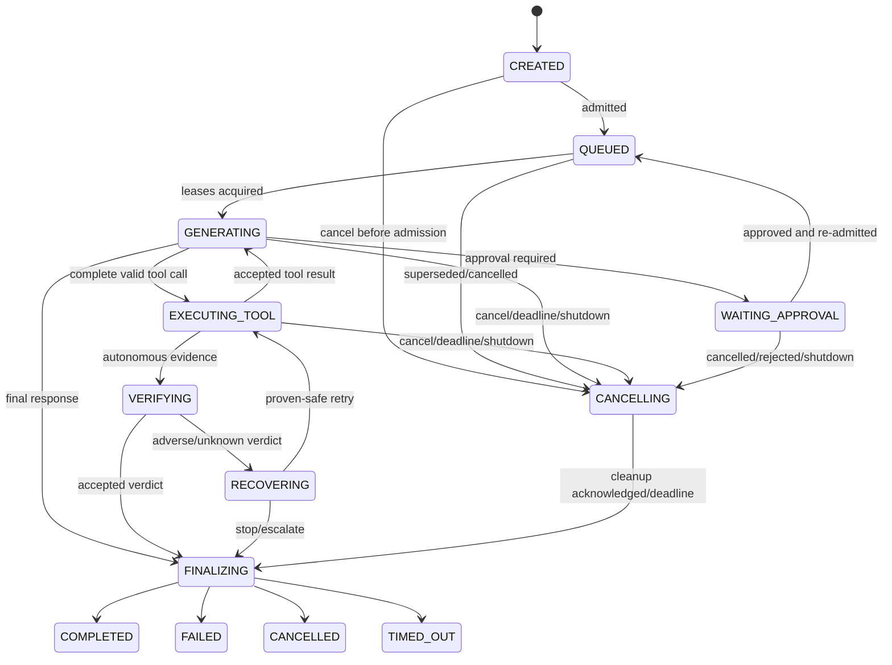

# Task 42.1 — Real-time turn lifecycle architecture

Status: architecture only; proposed contracts below are **not implemented**.
Baseline: `d425ebe0e143d57ab6319583cab7f21ba24e5a29`.

## Scope and invariants

This design adds a real-time coordination layer without changing capability
authority. `ToolExecutor` remains the only execution path:
`ToolRegistry.get` → `Tool.validate_args` → `PermissionPolicy.check` →
`Tool.run` → normalization/logging → `ToolInvocation`. Cancellation and
deadlines are trusted execution context, never model arguments, and may stop a
call but never authorize one.

Conversation session history, autonomous `AgentState`, durable memory, turn
coordination records, and the future action journal remain distinct stores.
Personality and voice presentation sit above these boundaries. Verification
does not execute tools or grant permission; recovery remains bounded and
cannot rewrite failure or unknown evidence as success. Existing filesystem and
permission behavior is frozen.

## Current-state findings

- `agentcore.core.agent.Agent.__init__`/`build_agent` own composition. One
  `PermissionPolicy`, `ToolRegistry`, workspace guard, and `ToolExecutor` are
  constructed; `Agent._build_tool_runner` gives that same executor and policy
  to `ConversationToolRunner`, while `TaskRunner` receives it at line-of-
  authority construction. `Agent.execute`, `run_task`, `_execute_once`,
  `checkpoint`, and `resume` synchronously own autonomous execution and its
  workspace-pinned state.
- `ConversationRuntime.send` appends the user message, retrieves memory,
  synchronously calls `_generate`, captures only the user turn, then saves the
  `ConversationSession`. `_generate` is a bounded sequential
  model → tools → model loop. `ConversationToolRunner.run_calls` intentionally
  executes calls sequentially and routes every valid call to
  `ToolExecutor.invoke`.
- `BaseModelProvider.generate` and `complete`, `LLMPlanner._ask_model`, model-
  assisted verification, and `OpenAICompatibleProvider.generate` are blocking.
  `HttpClient.post_json` owns bounded synchronous retries and sleeps between
  attempts. `urllib` has a per-I/O timeout, but no cancellation propagation or
  streaming contract.
- `TaskRunner.run` executes one ready subtask at a time, records the returned
  invocation through `AgentState.record_tool_call`, then verifies and possibly
  recovers. `Verifier` has no executor and judges recorded evidence.
  `RecoveryPolicy` is deterministic, bounded, does not execute, treats
  `UNVERIFIED` as adverse, and only retries when `assess_retry_safety` proves it
  safe.
- `AgentState.transition_phase` owns autonomous phase legality;
  `JsonFileStateStore` atomically persists it. `ConversationSession` and
  `JsonFileSessionStore` independently persist dialogue. Neither is an
  appropriate owner for a real-time turn state machine. `TaskStatus.CANCELLED`
  is already terminal and non-recoverable, but there is no turn cancellation
  path; `Agent.shutdown` only checkpoints and logs.
- `PermissionPolicy.evaluate` exposes approval-required proposals;
  `PermissionPolicy.check` resolves terminal allow/deny. Conversation prechecks
  approval without running; CLI approve/reject records a decision but never
  executes an action.
- `ToolConfig.default_timeout_seconds` and `tools.max_retries` are validated but
  not consumed by `ToolExecutor`. They are not functioning timeout controls.
  `ModelConfig.timeout_seconds` reaches each HTTP attempt, but retries do not
  share one overall request or turn deadline.
- `SystemClock`/`FixedClock` already provide wall and monotonic time. There is
  no turn coordinator, stream event type, cancellation token, stale-result
  fence, action journal, stable invocation/action ID, or concurrency contract.
  Production creates no worker threads or event loop; the only runtime lock is
  the monotonic timestamp guard.

## A. Turn identity and state

A `Turn` is one admitted user interaction. It belongs to exactly one
conversation session and may *link* to an autonomous run, task, subtask, and
tool/action records; it does not contain or replace them. Autonomous work not
originating from a conversation has no turn. A turn-triggered autonomous run
stores `origin_turn_id`; the turn stores optional `run_id`, never the task
object.

`TurnCoordinator` is the sole creation authority. It uses an injectable ID
factory, defaulting to existing `new_id("turn")`, yielding immutable
`turn_<12 lowercase hex>` IDs. Each admitted turn also receives a per-session
monotonic `generation`; all callbacks and events carry both values. Provider
call IDs, model tool-call IDs, `ToolInvocation`s, and future action IDs remain
separate correlation identifiers.



| From | Legal destinations | Rule |
|---|---|---|
| `CREATED` | `QUEUED`, `CANCELLING` | Persist identity before work. |
| `QUEUED` | `GENERATING`, `CANCELLING` | Only the current session generation starts. |
| `GENERATING` | `EXECUTING_TOOL`, `WAITING_APPROVAL`, `FINALIZING`, `CANCELLING` | Malformed calls fail; they never enter execution. |
| `EXECUTING_TOOL` | `GENERATING`, `VERIFYING`, `FINALIZING`, `CANCELLING` | Only an accepted, non-stale result advances work. |
| `WAITING_APPROVAL` | `QUEUED`, `CANCELLING` | Approval reacquires leases and rechecks policy. |
| `VERIFYING` | `RECOVERING`, `FINALIZING`, `CANCELLING` | Verification consumes evidence only. |
| `RECOVERING` | `EXECUTING_TOOL`, `FINALIZING`, `CANCELLING` | Retry requires existing safety and budget rules. |
| `CANCELLING` | `FINALIZING` | Cancellation is requested, not instantly terminal. |
| `FINALIZING` | one terminal state | Terminal choice is fixed before finalization. |
| terminal | same state only | Identical replay is a no-op; any different target errors. |

`COMPLETED`, `FAILED`, `CANCELLED`, and `TIMED_OUT` are terminal. Deadline
expiry uses `TIMED_OUT`; user/operator/supersession/shutdown uses `CANCELLED`;
internal faults use `FAILED`. A separate action outcome may remain `UNKNOWN`.

Proposed, not implemented:

```python
@dataclass(frozen=True)
class TurnSnapshot:
    turn_id: str
    session_id: str
    generation: int
    phase: TurnPhase
    schema_version: int = 1
    run_id: str | None = None
    requested_terminal: TurnPhase | None = None
    cancellation_reason: CancellationReason | None = None

class TurnController(Protocol):
    def snapshot(self) -> TurnSnapshot: ...
    def transition(self, expected: TurnPhase, target: TurnPhase, *,
                   operation_id: str, note: str = "") -> TurnSnapshot: ...
    def accepts(self, *, generation: int, operation_id: str) -> bool: ...
```

`TurnRecord` schema version 1 is durable: IDs/links, generation, phase and
transition ledger, timestamps, wall-clock deadline, cancellation reason,
terminal outcome, bounded counters, and action references. Raw partial model
text, tool content, tokens, locks, listeners, monotonic clock values, provider
objects, and stream accumulators are ephemeral. Store records atomically in a
new turn store, not session or run state. On restart, a nonterminal turn is
reconciled to cancellation/failure; it is never silently resumed. An action
already started is reconciled separately and may remain `UNKNOWN`.

Only `TurnCoordinator` admits/supersedes; a `TurnController` for that record
performs validated transitions; stage owners report results through the
controller. Callers receive immutable snapshots, not mutable records.

## B. Concurrency and interruption

The supported scope is **one active logical turn per conversation session**.
Different sessions may be admitted independently, but the first implementation
serializes model calls per `Agent` because current providers promise no
reentrancy, and serializes all tool calls per `Agent` through one action lane.
Current autonomous execution also remains one run at a time per `Agent` because
`Agent.state` is singular. Read-only tools do not run concurrently initially:
`read_only` proves effect class, not thread safety or resource independence.
Later concurrency requires an explicit audited `concurrency_safe` contract.

### Process and turn-store ownership

Version 1 supports one owning AgentCore process for a given turn/session store.
Multi-process concurrent ownership is unsupported and must fail safely rather
than permit competing writers. `TurnCoordinator` owns in-process admission
linearization with a short per-session mutex. The durable turn store must expose
optimistic compare-and-swap semantics, conceptually:

```python
def compare_and_swap(
    self,
    turn_id: str,
    expected_version: int,
    next_record: TurnRecord,
) -> TurnRecord: ...
```

`TurnController.transition()` uses the record version plus `operation_id` for
idempotent replay and stale-transition rejection. Disk persistence must be
crash-safe and atomic, but atomic file replacement alone is not multi-process
concurrency control. If a conflict is detected, the losing operation reloads
and rechecks the record and must never overwrite a newer turn record.

The file-backed store flushes record contents before atomic replacement on all
supported platforms. POSIX additionally fsyncs the containing directory for
stronger metadata durability. Windows does not claim a directory-metadata
flush, so sudden power loss may lose the newest replacement despite the
concurrent-write/CAS guarantees remaining intact.

Store I/O and callbacks happen outside coordinator, session, model-lane, and
action-lane locks. Those locks are never waited on while another is held. If an
implementation ever must acquire more than one, order is coordinator → session
→ model → action → store; reverse acquisition is forbidden.

### Successor admission

Coordinator-lock acquisition order is the only version-1 definition of
“newest”; UI timestamps and wall-clock time do not determine ordering. When
another user input arrives for the same session, the active turn is cancelled
with `SUPERSEDED`. There may be only one queued successor. If one is already
queued, it is cancelled with `SUPERSEDED_BEFORE_START` and replaced by the
newly admitted successor. Every accepted input still has its own durable
terminal turn record. No model or tool work begins for a turn after its
generation is no longer current.

The user message is appended once, in generation order, under the session
mutation lease before model work; an interrupted user message stays in the
transcript, while stale/partial assistant output does not. Waiting for approval
holds no model/tool lane. Interruption during verification or recovery stops
further decisions; during tool execution it requests cancellation but cannot
erase possible effects.

Every callback is accepted only when `(session_id, turn_id, generation,
operation_id)` matches the current lease and expected phase. Stale model events
are discarded. Late tool/action results are still journaled as evidence, but
cannot update conversation history, a successor turn, or a terminal outcome.

```mermaid
sequenceDiagram
    participant U as User/UI
    participant C as TurnCoordinator
    participant O as Old stage
    participant N as New turn
    U->>C: submit new input(session)
    C->>O: cancel(SUPERSEDED)
    C->>C: increment generation; queue new turn
    O-->>C: late delta/result(old generation)
    C--xO: reject stale event; journal if action evidence
    O->>C: cleanup acknowledged or cleanup deadline
    C->>N: acquire stage lease
    N->>N: generate using new turn/generation
```

Required race tests cover simultaneous admission, cancel-versus-permission,
cancel-versus-final response, deadline-versus-result, stale deltas, tool return
after supersession, late verifier/recovery, shutdown while approval waits, and
cleanup deadline expiry.

## C. Cancellation contract

Proposed, not implemented:

```python
class CancellationReason(Enum):
    USER_INTERRUPT = "user_interrupt"
    SUPERSEDED = "superseded"
    OPERATOR_CANCEL = "operator_cancel"
    DEADLINE_EXCEEDED = "deadline_exceeded"
    AGENT_SHUTDOWN = "agent_shutdown"
    INTERNAL_FAILURE = "internal_failure"

class CancellationToken(Protocol):
    @property
    def requested(self) -> bool: ...
    @property
    def reason(self) -> CancellationReason | None: ...
    def raise_if_requested(self) -> None: ...
    def register(self, callback: Callable[[CancellationReason], None]
                 ) -> CancellationRegistration: ...

class CancellationSource:
    token: CancellationToken
    def cancel(self, reason: CancellationReason, *, detail: str = "") -> bool: ...
    def child(self) -> CancellationSource: ...
    def close(self) -> None: ...
```

The agent shutdown source is the root; each session admission creates a turn
child; each model/tool/verification/recovery operation gets a child. Session
supersession, user interruption, operator cancel, deadline checker, and internal
failure may cancel the turn source. First request wins atomically; later reasons
are secondary audit facts. `cancel` is idempotent. Registrations invoke once,
outside locks, and `close` removes listeners; terminal finalization closes the
whole tree.

The implementation may use standard-library `threading.Event`/`Lock` for
cross-caller signalling, but it creates no thread. This is required because a
UI or host callback must be able to request cancellation while synchronous work
is blocked; it is not permission to introduce background execution.

Cancellation is cooperative for existing Python/provider/tool boundaries:
check before/after blocking calls, between retry sleeps, before permission
evaluation, after permission and before `Tool.run`, and before every state or
session commit. AgentCore never kills a Python thread. Preemption is permitted
only for a resource it owns and can cleanly terminate later (process handle,
HTTP stream, browser session). An already-issued OS input or external mutation
cannot be undone by cancellation.

Before `Tool.run`, cancellation yields a non-executed categorical result.
During a cooperative read, cancellation yields cancelled evidence. A successful
late result remains truthful invocation evidence but is marked stale and is not
delivered. A mutation cancelled after start records effect `UNKNOWN` unless an
authoritative acknowledgement proves otherwise. Cancellation itself is not a
retryable failure; recovery does not run for cancelled/timed-out turns.

## D. Provider-neutral streaming

The core consumes a synchronous, pull-based iterator—natural backpressure, no
queue, thread, `asyncio`, or third-party dependency. Every proposed event uses
this common correlation envelope:

```python
@dataclass(frozen=True)
class StreamEventEnvelope:
    turn_id: str
    session_id: str
    generation: int
    operation_id: str
    request_id: str
    attempt_id: str
    sequence: int  # Monotonically increasing within one attempt.
```

The event payload variants remain:

```python
StreamStarted(model, provider)
TextDelta(text)
ToolCallDelta(index, call_id=None, name_fragment="", arguments_fragment="")
ToolCallCompleted(index, call: ToolCall)
UsageUpdated(usage: Usage)
ResponseCompleted(response: ModelResponse, completion_metadata: Mapping)
StreamFailed(error_kind, retryable)
StreamCancelled(reason)

class StreamingModelProvider(Protocol):
    def stream(self, request: ModelRequest, *, context: OperationContext
               ) -> Iterator[ModelStreamEvent]: ...
```

Events are ordered per attempt, sequences never repeat, and exactly one
terminal event is accepted. Deltas are provisional. Partial text may be shown
to the current UI but is never saved to `ConversationSession`, captured into
memory, or treated as a final assistant reply. Only `ResponseCompleted` commits
the canonical assistant message and final usage. Bounded counts/status may be
persisted for audit, never raw partial content.

Tool fragments are accumulated in the provider adapter under byte/character
limits. No repair, `eval`, or partial JSON is allowed. Execution is eligible
only after an explicit completed call with nonempty name/ID, arguments decoded
to a JSON object, and the enclosing response completes successfully. It then
enters the existing `ConversationToolRunner`/`ToolExecutor` path. A malformed or
incomplete call fails the model operation and executes nothing.

Transparent model retry is allowed only before any semantic delta becomes
visible. After text or tool-call deltas are published, failure terminates that
attempt; automatic replay could duplicate visible output and is forbidden.
Tool calls are never executed from a failed attempt. A one-shot adapter can
turn existing `generate` into `StreamStarted` + `ResponseCompleted`; the first
streaming provider adds `stream` beside, not inside, conversation core logic.

## E. Deadlines and timeouts

`Deadline` carries an absolute monotonic expiry for decisions and an UTC expiry
for persistence. Child deadlines are `min(parent, requested budget)` and can
never extend an outer deadline. `SystemClock`/`FixedClock` are injected; wall
time is never used for elapsed decisions.

```python
@dataclass(frozen=True)
class OperationContext:
    turn_id: str
    generation: int
    operation_id: str
    cancellation: CancellationToken
    deadline: Deadline

class Deadline(Protocol):
    def remaining(self, clock: Clock) -> float: ...
    def expired(self, clock: Clock) -> bool: ...
    def child(self, max_seconds: float, clock: Clock) -> Deadline: ...
```

- Turn deadline bounds admission through final response.
- Each model request shares one child deadline across all retries; every I/O
  timeout and backoff is clamped to remaining time.
- Tool deadline is the minimum of turn remaining, existing
  `tools.default_timeout_seconds`, and trusted per-tool setting.
- Cleanup receives a separate short grace deadline after cancellation; expiry
  makes the logical turn terminal but does not make an unknown action safe.

User cancellation ends as `CANCELLED`; deadline expiry ends as `TIMED_OUT` and
emits timeout evidence. Ordinary failure ends as `FAILED`. If blocking code
cannot be interrupted, its lease is stale-fenced. Model-only work may drain;
its model lane remains quarantined until physical return unless that provider
has a separately proven concurrent-request contract. The global action lane
remains quarantined while a possibly mutating call is physically live or
unresolved. Future processes use graceful stop then owned process-tree
termination; browser/PC actions close owned sessions and reconcile state. They
never assume that timeout rolled back an action.

Migration first threads deadlines through trusted contexts without enforcing
tool preemption. Then retry sleeps and provider I/O consume remaining budget.
Only tools that implement cooperative checkpoints or owned-resource cleanup may
claim interruptibility. This fixes the unused `ToolConfig` gap without changing
Task 41.3 validation, permission, or filesystem authority.

## F. Side effects and recoverability

Future tools must declare `READ_ONLY`, `IDEMPOTENT_MUTATION`,
`NON_IDEMPOTENT_MUTATION`, or `IRREVERSIBLE_EXTERNAL`; current `read_only` maps
only to the first/unknown split until separately migrated. No mutation tool is
added here.

A separate durable `ActionJournal` serves conversation and autonomous paths.
After validation and permission allow, but before `Tool.run`, `ToolExecutor`
persists an intent with generated action ID, turn/run/task/subtask links,
effect class, redacted argument fingerprint, permission decision, and
`PREPARED` status. `STARTED` is persisted immediately before crossing the
side-effect boundary; `ACKNOWLEDGED` stores an external receipt; terminal
`SUCCEEDED`/`FAILED` follows evidence. Interruption without decisive evidence
records `UNKNOWN`. The action ID is the idempotency key where the external API
supports one.

Read-only work is retryable under existing bounds. Idempotent mutation is
retryable only with the same key and a provider guarantee. Non-idempotent or
irreversible work is retryable only when evidence proves it never started.
After ambiguous timeout/cancellation, a separately admitted read-only
reconciliation action may gather evidence through `ToolExecutor`; `Verifier`
only judges that evidence. Otherwise recovery escalates to an operator.
`UNKNOWN` is never converted to success by model, verifier, recovery, or
restart logic.

Proposed, not implemented:

```python
class ActionBoundary(Protocol):
    def mark_started(self, *, action_id: str) -> ActionRecord: ...
    def acknowledge(
        self, *, action_id: str, receipt: Mapping[str, str]
    ) -> ActionRecord: ...
    def fail(self, *, action_id: str, error: ErrorRecord) -> ActionRecord: ...
    def mark_unknown(self, *, action_id: str, reason: str) -> ActionRecord: ...
```

`ToolExecutor` creates and durably records `PREPARED` only after real argument
validation and permission allow. A future mutation-capable tool receives this
trusted context and must call `mark_started()` immediately before its first
external side effect. It cannot report definitive success without authoritative
acknowledgement or evidence. Cancellation, timeout, crash, or physical return
after `STARTED` without decisive acknowledgement produces `UNKNOWN`. Future
reconciliation remains a separately admitted read-only action through
`ToolExecutor`. `ActionBoundary` is trusted execution context for future
controlled capabilities and is never supplied through model-controlled
arguments.

### Future Gmail and external API integration contract

Gmail is not implemented in Task 42.1 or Task 42.2. Any future Gmail or external
API integration must use OAuth with least-privilege, user-granted scopes; it
must never place passwords or tokens in source, normal configuration, logs,
state, or prompts. Read, draft, send, modify, and delete are separate
capabilities. Recipient resolution occurs before an action, and sending requires
explicit confirmation by default.

External mutations use action IDs/idempotency keys or provider message
identifiers to prevent duplicate sends on retry and retain durable, redacted
intent/result records. Cancellation distinguishes “not submitted” from
“submission outcome unknown.” Incoming email and API text is untrusted data,
never authority or system instructions. Every external action routes through
the same `ToolExecutor`, permission, action-journal, verification, and recovery
boundaries.

## G. Observability, latency, and privacy

Add canonical events: `turn.created`, `turn.queued`, `turn.admitted`,
`turn.model_started`, `turn.first_token`, `turn.tool_started`,
`turn.tool_finished`, `turn.cancellation_requested`,
`turn.cancellation_acknowledged`, `turn.timed_out`,
`turn.stale_result_rejected`, `turn.finalization_started`, and
`turn.finalized`. Bind turn/session/generation and optional run/task/subtask,
operation, call, and action IDs.

Metrics are admission delay, time-to-first-token, model/tool/verification/
recovery latency, total turn latency, cancellation acknowledgement/finalization
latency, stale-event count, and deadline/terminal counts. Reserve
time-to-first-audio but emit nothing until voice exists. Use monotonic durations.
Logs/metrics contain no user/model raw text, raw tool content, arguments,
secrets, sensitive or resolved filesystem paths, external targets, or partial
tool JSON. Reuse structured redaction and log categorical outcomes, lengths,
effect class, and hashes only where needed.

## H. Configuration and staged implementation

The first foundational slice needs **no configuration**: ID format, legal
transitions, cancellation taxonomy, serialization version, and one active turn
per session are invariants, not operator tuning. Existing load precedence stays
defaults < TOML < `AGENTCORE_*` < explicit overrides.

The later deadline-integration slice adds only
`conversation.turn_deadline_seconds=120.0` (valid 1–3600) and
`conversation.cleanup_timeout_seconds=5.0` (valid 0.1–30). A trusted explicit
API deadline may shorten, never lengthen, configuration. Model work is also
clamped by existing `model.timeout_seconds`; tools by existing default/per-tool
timeouts. Streaming buffer caps begin as internal conservative constants and
become configuration only with evidence that operators need tuning.

1. **Foundation.** Add internal `agentcore.realtime.turn`, `cancellation`, and
   `store` with schema-v1 records, deterministic transition controller,
   token/source tree, fixed-clock support, and atomic JSON store. No integration
   or public behavior change. Unit-test every transition, idempotency, callback
   cleanup, serialization, restart reconciliation, and simultaneous cancels.
   Rollback is removal of an unused internal package.
2. **Admission and one-shot conversation integration.** Add `TurnCoordinator`
   at `Agent.conversation` composition, create/admit before `send`, serialize
   session mutation, fence model results, and persist final turn state. Existing
   synchronous provider API remains. Integration-test simultaneous inputs,
   supersession before/during generation, provider ignoring cancellation, and
   session reload. Preserve the existing one-shot provider path as the
   compatibility adapter and rollback boundary.
3. **Deadlines and autonomous correlation.** Add trusted `OperationContext`,
   deadline clamping to model transport/retry sleep, cooperative checkpoints in
   `TaskRunner`, and turn/run correlation without changing `AgentState` phases.
   Test fixed-clock expiry at every boundary, late verifier/recovery rejection,
   shutdown, approval waits, and workspace/permission invariants. Do not claim
   tool preemption yet.
4. **Streaming core and first provider.** Add event schemas, accumulator,
   one-shot adapter, synchronous iterator consumption, then one provider stream
   adapter. Test ordering, backpressure, retry-before-first-delta, malformed
   tool fragments, bounds, cancellation, stale events, and final-only session/
   memory persistence. Existing `generate`/`complete` remain compatible.
5. **Interruptible tools and action journal.** Extend trusted `ToolContext` and
   `ToolExecutor` around—not around the side—of the existing authority path;
   introduce effect classes, intents, acknowledgements, and reconciliation.
   Test every cancel/permission/action race and crash point. Rollout requires a
   separate security review before any mutation/browser/PC capability.

## Adversarial acceptance scenarios

| Scenario | Owner and persisted evidence | Accepted result; recovery/escalation |
|---|---|---|
| Interrupt before model start | Coordinator; queued/cancel transition | `CANCELLED`; no recovery/escalation. |
| Interrupt during output | Model stage; partial counts and cancel reason | `CANCELLED`; partial not persisted; no recovery. |
| Interrupt after parsed call, before executor | Controller; completed call plus no action intent | `CANCELLED`; tool never runs; no recovery. |
| Interrupt during read-only tool | Executor/token; invocation or late-result record | `CANCELLED`; successor may explicitly reissue; no automatic recovery. |
| Mutation interrupted after possible effect | Executor/action journal; `STARTED`, receipt if any | Turn cancelled/timed out, action `UNKNOWN`; no retry; operator required. |
| Model event after supersession | Coordinator generation fence; stale-event event | Old turn remains terminal; discard; no recovery/escalation. |
| Tool returns after timeout/cancel | Executor/action journal; truthful late invocation | No turn advancement; read-only recorded, mutation may be `UNKNOWN`; escalate latter. |
| Late verifier/recovery callback | Controller operation fence; stale callback event | Terminal state unchanged; no recovery/escalation. |
| Two simultaneous inputs | Coordinator admission lock; both turn records/generations | Lock winner starts then is superseded by latest; earlier cancelled; no escalation. |
| Shutdown while approval waits | Root source; pending approval and shutdown reason | `CANCELLED`; approval revoked/retained only as audit; no execution or recovery. |
| Restart with ambiguous action | Restart reconciler/action journal | Turn terminal, action `UNKNOWN`; no automatic resume/retry; operator required. |
| Provider temporarily ignores cancel | Model lease/fence; requested/ack latency | Turn cancels after cleanup grace; late events discarded; no recovery. |
| Malformed/incomplete streamed args | Provider accumulator; categorical parse error, lengths only | `FAILED`; executor not entered; retry only if no semantic delta was exposed. |
| Deadline expires during cleanup | Controller/deadline; cleanup-expired event | `TIMED_OUT`; stale fence remains; unknown action quarantines lane and escalates. |
| Cancellation races permission denial | Executor checkpoints; decision plus cancellation order | Tool never runs. Cancellation wins before final commit; denial remains evidence; no recovery. |

## Non-goals and Task 42.1 acceptance

No runtime streaming, provider change, voice, browser/PC control, shell/process,
network tool, scheduler, database, capability, concurrency worker, timeout
enforcement, or cancellation behavior is implemented by Task 42.1. It does not
alter `AgentState`, `ToolExecutor`, permissions, filesystem rules, verification,
recovery, or persistence behavior.

Task 42.1 is accepted when this document identifies current owners, fixes every
state/concurrency/cancellation/stream/deadline/effect/observability/configuration
decision, defines stale and unknown semantics, covers the adversarial cases,
and supplies independently testable implementation stages. **No runtime code
was implemented.**

## Task 42.3 integration amendment — 2026-08-21

Status: **approved project-lead decisions; architecture only, no runtime code
implemented by this amendment.**

Baseline: this document plus accepted Task 42.2 implementation
`797e2f5c8087423d72a2e972adaa350b47b4393f`. Task 42.2 is complete.

This amendment settles the integration questions raised against stage 2
(*Admission and one-shot conversation integration*) in section H. It refines
the wording of sections B, E, G and H where noted; it does not introduce a new
architecture, a new capability, a new configuration key, or a new durable
schema version. `TURN_SCHEMA_VERSION` remains `1`. Every invariant in *Scope
and invariants* stands unchanged: `ToolExecutor` remains the only execution
authority, permissions and filesystem behavior are frozen, and personality and
presentation remain above runtime authority.

### 1. Per-Agent stage lease (settles C-1)

Stage 2 adds one **per-`Agent` reentrant stage lease**. It is the concrete
implementation of the "stage lease" referenced in section B's successor
admission sequence, and it is the only mechanism permitted to serialize model
and tool work within one `Agent`.

Ownership and ordering rules:

- Admission never waits for the stage lease and never holds it.
  `TurnCoordinator.admit` continues to acquire only its short per-session
  admission lane.
- A newly admitted successor may therefore cancel the active turn and queue
  itself **while its predecessor is physically running**. Supersession
  ordering remains coordinator-lock acquisition order, never wall time.
- The stage owner acquires the stage lease **before** transitioning
  `QUEUED → GENERATING`.
- The owner holds the lease across: the synchronous provider call; any
  conversation tool round; the stale-fence decision; every session mutation
  owned by that turn; and the turn's final durable transition.
- The owner **terminalizes its durable turn record before releasing the
  lease**.
- A successor cannot begin model or tool work until the predecessor has
  terminalized and released the lease. This preserves the coordinator's
  requirement that at most one non-terminal turn per session is past `QUEUED`.

Lock-discipline rules, which refine the section B sentence "Store I/O and
callbacks happen outside coordinator, session, model-lane, and action-lane
locks":

- No coordinator mutex is held while waiting for or acquiring the stage lease.
- No session lock is held while waiting for the stage lease.
- Session locking is narrow. It may be taken **inside** the stage lease, and
  only for append and save operations.
- No `TurnStore` internal lock is held while calling provider or tool code.
- The minimal trusted `TurnStore` and session persistence required to
  terminalize a turn and hand off to a successor **may** occur while the stage
  lease is held.

The final bullet is the intended refinement. The older blanket wording is
superseded for stage 2 only, and only for this minimal terminalize-and-hand-off
persistence; it remains in force for coordinator, session and action lanes and
for all other store I/O.

Cancellation remains **cooperative only** in Task 42.3, consistent with
section C. A provider or tool that ignores cancellation keeps the successor
waiting until physical return, exactly as section E's "quarantined until
physical return" already states. Task 42.3 therefore delivers correct turn
accounting, supersession and stale fencing, and **must not claim barge-in
latency, forced interruption, or preemption**. No worker thread is introduced.

### 2. Opaque turn-session correlation key (settles C-2)

Existing `ConversationSession` and CLI session-ID validation is **not**
tightened. Session identity remains whatever current session behavior accepts.

`TurnRecord.session_id` stores a **derived correlation key**, never the raw
`ConversationSession` identifier:

- Derive from the exact UTF-8 bytes of the raw session ID using a
  domain-separated SHA-256 digest, rendered as lowercase hexadecimal and
  prefixed with `session_`.
- The domain separator is a fixed constant reserved for this purpose, so the
  digest cannot collide with any other AgentCore key derivation.
- The result satisfies the existing safe `TurnRecord` link-ID charset and
  length rules without transformation, truncation, or escaping.
- Derivation is deterministic, collision-resistant, and one-way: the raw
  session ID is not recoverable from the record.
- Session IDs containing spaces, Unicode, `#`, `.`, `..`, or any length the
  current session layer accepts remain compatible, because none of those bytes
  reach the turn record.
- The caller still rejects an empty raw session ID before derivation; an empty
  input is a caller error, not a valid correlation key.

Observability follows the same rule. Turn events, turn metrics and any
turn-result correlation field expose the safe derived key only. The raw session
ID is never written into a `TurnRecord`, a turn event, or a turn metric. This
refines section G's binding requirement accordingly.

### 3. Durable turn-store ownership is opt-in (settles C-3)

Task 42.3 is **opt-in**:

- Existing `Agent` and CLI behavior is unchanged when no realtime coordinator
  or turn store is explicitly injected. With nothing injected, conversation
  behaves exactly as it does today; this is the stage-2 rollback boundary
  required by section H.
- Task 42.3 does **not** automatically create a `JsonFileTurnStore`.
- Task 42.3 adds **no** configuration for turn-store placement, and section H's
  "first foundational slice needs no configuration" continues to apply.
- An explicit host-injected durable `JsonFileTurnStore` is responsible for
  single-process ownership, exactly as *Process and turn-store ownership*
  already specifies.
- If explicit durable ownership fails, the failure is **categorical**. It never
  silently downgrades to `InMemoryTurnStore`, and it never continues without
  the durability the host asked for.

This preserves today's multiple-CLI-process behavior until a later deployment
and configuration task defines durable-store placement and ownership policy.
That later task owns the decision; Task 42.3 does not pre-empt it.

### 4. Counters and session lookup cost (settles C-4)

- Task 42.3 does **not** mutate frozen `TurnRecord` counters. The accepted
  Task 42.2 CAS contract holds all non-transition fields, including
  `TurnCounters`, invariant for a record's life. Section A's counter list
  therefore describes reserved schema-v1 capacity, not a stage-2 write path.
- Stale-result, model-request and tool-call counts are reported through the
  privacy-safe observability events in section G. Those events carry
  categorical outcomes, counts and safe identifiers only, never raw text,
  arguments, tool content, or resolved paths.
- The coordinator's per-admission session lookup is O(all turns) in the store
  domain. This is recorded as a **known performance limitation** of stage 2.
  It is explicitly **not** a reason to redesign the turn store, add an index,
  or change CAS semantics during Task 42.3. A later task owns any bounded or
  indexed lookup.

### 5. `Deadline.unbounded()` scaffolding (settles C-5)

Stage 2 must not fabricate a far-future deadline to satisfy
`OperationContext`. Instead a named, non-enforcing semantic is defined:

- `Deadline.unbounded()` carries **no** monotonic expiry and **no** UTC expiry.
- `expired()` is always false for an unbounded deadline.
- No deadline is persisted on the turn record; `deadline_at` stays absent.
- A child deadline may later shorten an unbounded parent during the
  deadline-integration stage, consistent with section E's rule that a child is
  `min(parent, requested budget)` and can never extend an outer deadline.
- It is explicit scaffolding for the `OperationContext` the stale fence
  requires. It is **not** timeout enforcement, and it must never be described
  as one.

Turn, model-request, tool and cleanup budgets remain unimplemented in Task
42.3. Section E's migration ordering is unchanged: deadlines are threaded
through trusted contexts in the later stage, and tool preemption is still not
claimed.

### 6. Approval and provider-failure categories (settles C-6 and C-7)

- Existing approval behavior remains **non-blocking** in Task 42.3. A tool call
  that requires human approval is still pre-checked without executing, still
  escalates through the existing `PendingAction` path, and the turn may still
  complete normally with a truthful non-executed outcome.
- `WAITING_APPROVAL` and its `→ QUEUED` re-admission edge are **not used** in
  Task 42.3. They remain reserved in the section A state machine for the later
  stage that makes approval blocking. Leaving them unused is a deliberate,
  recorded deviation from the section A diagram, not a redesign of it.
- Ordinary provider generation failure terminalizes as `FAILED` with the
  existing `INTERNAL_FAILURE` cancellation category. No schema enum value is
  added in Task 42.3, because the cancellation vocabulary is durable
  schema-v1 state.
- This is **known categorical imprecision**: an external provider fault is
  recorded under an internal-failure category. It is accepted for Task 42.3 and
  assigned to whichever later stage revises the durable cancellation
  vocabulary under schema review.

### 7. Supersession vocabulary unchanged (settles C-9)

Task 42.3 does **not** change the existing `SUPERSEDED` /
`SUPERSEDED_BEFORE_START` vocabulary or the conditions under which the
coordinator selects between them. Both already terminalize as `CANCELLED` with
a durable, truthful record, so the distinction is audit vocabulary only.
Accepted Task 42.2 behavior stands.

### Task 42.3 acceptance checklist

Task 42.3 is accepted when all of the following hold:

1. A turn is created and admitted before any conversational model work, and
   every accepted input has its own durable terminal turn record.
2. At most one active logical turn per session, with at most one queued
   successor, is observable in the durable store at all times.
3. Session mutation and model calls are serialized per `Agent` by the stage
   lease and narrow session locking described above, with the stated
   acquisition and non-holding rules respected.
4. A successor admitted during a live turn supersedes it safely and begins
   model or tool work only after the predecessor has terminalized and released
   the stage lease.
5. A stale model result or a late tool result cannot mutate conversation
   history, a successor turn, or a terminal outcome; the interrupted user
   message still remains in the transcript.
6. Final turn state is durably persisted for success, failure, and
   cancellation, with no stranded non-terminal turn after error, shutdown, or
   restart reconciliation.
7. The existing synchronous one-shot provider path is unchanged and remains the
   compatibility adapter and rollback boundary.
8. `ToolExecutor` remains the single execution path, and all permission and
   approval behavior is byte-for-byte preserved.
9. `AgentState`, conversation session state, durable memory, and `TurnRecord`
   remain four separate stores linked only by opaque identifiers.
10. With no coordinator or turn store injected, behavior is identical to the
    pre-Task-42.3 baseline.
11. Turn records, turn events and turn metrics contain no raw session ID, user
    or model text, tool arguments or output, secrets, or resolved filesystem
    paths.

### Task 42.3 non-goals

Task 42.3 implements no streaming, no provider change, no voice, no turn
detection or barge-in, no browser or computer control, no shell, process or
network capability, no scheduler or background worker, no action journal or
effect classes, no mutation tooling, no deadline or timeout enforcement, no
tool preemption, no forced interruption, no blocking approval, no new
capability, no new configuration key, no dependency change, and no durable
schema change. It does not alter `AgentState` phases, `ToolExecutor`,
permissions, filesystem rules, verification, recovery, or existing persistence
behavior.
